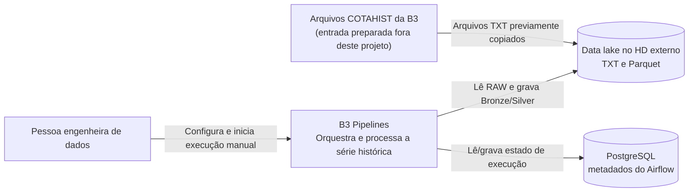
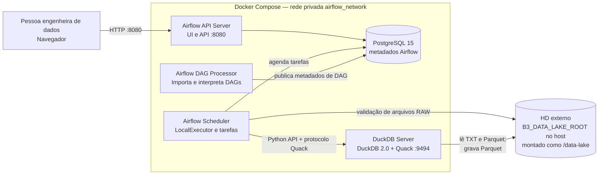
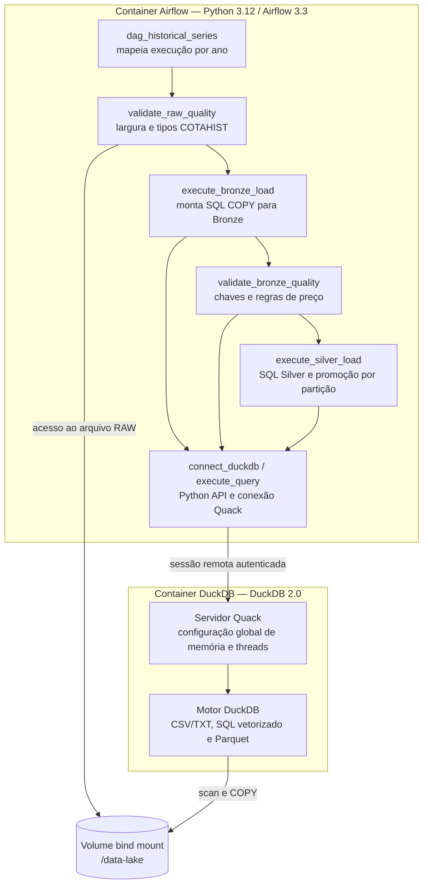

# B3 Pipelines

## Descrição

Pipeline ELT para a série histórica de cotações da B3 no layout COTAHIST. O
Airflow orquestra o fluxo e o DuckDB processa os arquivos e grava os resultados
em Parquet. Em Docker Compose, Airflow e DuckDB executam em serviços separados
e se comunicam pelo protocolo remoto Quack.

## Objetivo

Transformar arquivos COTAHIST já disponíveis no data lake em camadas Bronze e
Silver rastreáveis e particionadas, com verificações de qualidade antes de
promover dados para consumo analítico.

## O que faz

- Valida os arquivos RAW anuais: existência, linhas de 245 bytes e tipos de
  registro COTAHIST aceitos.
- Converte TXT para Parquet Bronze, acrescentando metadados de ingestão,
  arquivo-fonte, execução e ano.
- Verifica a qualidade Bronze, incluindo chaves, preços e faixas de preço.
- Transforma e deduplica as cotações Silver, atualizando apenas as partições
  anuais solicitadas e preservando a saída anterior se a promoção falhar.
- Processa anos de forma independente no Airflow; a falha em um ano não impede
  os outros anos do mapeamento de serem executados.
- Mantém os dados do lake em arquivos no caminho configurado no host, visível
  aos dois serviços Docker como `/data-lake`.

## O que não faz

- Não baixa os arquivos da B3: os TXT COTAHIST precisam estar no data lake
  antes da execução.
- Não usa PostgreSQL para armazenar as cotações. PostgreSQL guarda somente os
  metadados e o estado do Airflow.
- Não fornece dashboard de negócio, API analítica, catálogo de dados ou camada
  Gold.
- Não inicia ingestões agendadas: a DAG é manual (`schedule=None`).
- Não é um cluster distribuído ou de alta disponibilidade. O Compose usa
  `LocalExecutor` e um único servidor DuckDB/Quack.
- Não expõe Quack diretamente ao host nem configura TLS para a rede interna do
  Compose. Para acesso externo, é necessário um proxy reverso com TLS.

## Fluxo funcional

Para cada ano selecionado na execução manual:

1. Airflow valida o COTAHIST RAW no volume compartilhado.
2. O worker solicita ao DuckDB remoto a leitura do TXT e a gravação Bronze.
3. Airflow valida os Parquets Bronze mais recentes daquele ano.
4. DuckDB lê Bronze, transforma, deduplica e grava Silver em staging.
5. O worker promove somente a partição Silver do ano após a escrita concluir.

As transformações, filtros, agregações e escritas Parquet são executados pelo
motor DuckDB; Python controla conexões e fluxo. A validação RAW percorre as
linhas em Python para conferir largura e tipo de registro. A API Python não
implica por si só perda de desempenho: o que deve ser evitado para cargas
grandes é materializar o conjunto inteiro no processo Python ou iterar
registro a registro para transformar dados.

## C4 Model

Os diagramas abaixo usam Mermaid `flowchart` para representar os níveis C1
(contexto), C2 (containers) e C3 (componentes).

### C1 — Contexto do sistema



### C2 — Containers e relações



### C3 — Componentes principais



## Stack utilizada

| Tecnologia | Uso |
|---|---|
| Python 3.12 | DAG, validação RAW e integração com DuckDB |
| Apache Airflow 3.3.1 | API/UI, agendamento e processamento das tarefas |
| `LocalExecutor` | Execução local das tarefas do Airflow |
| DuckDB 2.0.0 | Motor analítico e conversão de TXT/Parquet |
| Quack | Protocolo HTTP interno entre clientes Python DuckDB e o servidor |
| PostgreSQL 15 | Banco de metadados persistente do Airflow |
| Docker Compose | Orquestração do ambiente local |
| Parquet + compressão ZSTD | Armazenamento das camadas Bronze e Silver |
| HD externo montado pelo Docker | Data lake persistente compartilhado pelos serviços |

O Python API é usado como interface cliente; SQL permanece no DuckDB. O
servidor é uma única instância. `DUCKDB_MEMORY_LIMIT` e `DUCKDB_THREADS`, do
`.env`, e `DUCKDB_PRESERVE_INSERTION_ORDER`, do código, são configurações
globais compartilhadas por todas as tarefas. Os parâmetros de uma execução
Airflow precisam corresponder aos valores do `.env`. Com
`BRONZE_MAX_WORKERS=4`, até quatro tarefas mapeadas podem competir pelos
recursos globais e pela largura de banda do mesmo disco. Ajuste concorrência,
threads e memória em conjunto, considerando os recursos alocados ao Docker
Desktop.

## Data lake

O caminho no host é definido em `B3_DATA_LAKE_ROOT`. A configuração atual do
ambiente local aponta para `/mnt/d/b3_datalake`. O mesmo diretório do host é
montado nos containers Airflow e DuckDB como `/data-lake`, portanto não existe
cópia intermediária do dataset para o filesystem efêmero dos containers.

```text
<B3_DATA_LAKE_ROOT>/
├── raw/
│   └── cotahist/
│       └── ano=2024/
│           └── COTAHIST_A2024.TXT
├── bronze/
│   └── cotahist/
│       └── year=2024/
│           └── _ingested_date=<timestamp>/
│               └── *.parquet
└── silver/
    └── cotacoes_historicas/
        └── year=2024/
            └── *.parquet
```

Os nomes e diretórios efetivos podem ser personalizados por
`B3_RAW_COTAHIST_DIR`, `B3_BRONZE_COTAHIST_DIR` e
`B3_SILVER_COTAHIST_DIR`. No Compose, configure esses caminhos no namespace do
container, sob `/data-lake`, pois somente `B3_DATA_LAKE_ROOT` é montado do host.
A localização RAW é verificada pelo Airflow no volume compartilhado; as
consultas de transformação e validação Bronze são executadas no DuckDB.

O volume nomeado `postgres-db-volume` é separado do data lake e preserva o
banco do Airflow entre reinicializações. `docker compose down` não o remove;
`docker compose down -v` o apaga.

## Setup

### Requisitos

- Docker Desktop com Docker Compose v2 e recursos suficientes para o período
  COTAHIST processado.
- HD externo montado e acessível ao Docker Desktop/WSL.
- Arquivos COTAHIST no padrão de diretórios e nomes mostrado acima.

### Configuração de ambiente

Dentro de `B3-Pipelines`, `.env` é local e não deve ser versionado:

```sh
cd B3-Pipelines
cp .env.example .env
```

Se `.env` já existir, preserve-o e edite somente as variáveis necessárias.
Configure `B3_DATA_LAKE_ROOT` com o caminho absoluto do HD externo visível ao
Docker. Ajuste `AIRFLOW_UID` para o UID do usuário no Linux/WSL quando necessário
(por exemplo, o resultado de `id -u`).

Gere três valores aleatórios distintos para senhas e token; copie cada resultado
para sua variável no `.env`, sem reutilizar o mesmo valor:

```sh
python3 -c "import secrets; print(secrets.token_urlsafe(32))"
python3 -c "import secrets; print(secrets.token_urlsafe(32))"
python3 -c "import secrets; print(secrets.token_urlsafe(48))"
```

Preencha:

```dotenv
AIRFLOW_DB_PASSWORD=<primeiro valor>
AIRFLOW_ADMIN_USERNAME=admin
AIRFLOW_ADMIN_PASSWORD=<segundo valor>
QUACK_TOKEN=<terceiro valor>
```

`AIRFLOW_DB_PASSWORD` deve permanecer compatível com URL. Os valores gerados
por `token_urlsafe` atendem a esse requisito. Restrinja as permissões do
arquivo local:

```sh
chmod 600 .env
```

O volume PostgreSQL preserva a senha já inicializada; mudar
`AIRFLOW_DB_PASSWORD` no `.env` não altera automaticamente a senha dentro desse
banco. Faça a rotação do usuário no PostgreSQL antes de alterar esse valor em
um ambiente existente.

### Subir e conferir

```sh
docker compose config --quiet
docker compose up --build -d
docker compose ps
curl --fail http://localhost:8080/api/v2/monitor/health
```

O Airflow fica disponível em `http://localhost:8080` (ou na porta definida por
`AIRFLOW_PORT`). Entre com `AIRFLOW_ADMIN_USERNAME` e
`AIRFLOW_ADMIN_PASSWORD`.

### Operação e exemplos

```sh
# Consultar estado e logs
docker compose ps
docker compose logs --tail=100 airflow-api-server airflow-scheduler \
  airflow-dag-processor duckdb-server

# Conferir DAGs e erros de importação
docker compose exec airflow-dag-processor airflow dags list
docker compose exec airflow-dag-processor \
  airflow dags list-import-errors --output json

# Consultar a conta administrativa
docker compose exec airflow-api-server airflow users list

# Parar os serviços mantendo os dados persistentes
docker compose down
```

Na UI, abra `b3_cotahist_medallion_pipeline` e inicie uma execução manual.
Informe `start_year` e `end_year`; `memory_limit` e `threads` devem corresponder
a `DUCKDB_MEMORY_LIMIT` e `DUCKDB_THREADS` do `.env`, pois são configurações
globais do servidor compartilhado.

Para inspecionar diretamente a camada Silver com o cliente Python no container:

```sh
docker compose exec airflow-scheduler python -c \
  "from utils.duckdb_connection import connect_duckdb; \
c=connect_duckdb(); \
print(c.execute(\"SELECT year, count(*) FROM read_parquet('/data-lake/silver/cotacoes_historicas/**/*.parquet', hive_partitioning=true) GROUP BY year ORDER BY year\").fetchall()); \
c.close()"
```

### Execução local sem Compose

Para desenvolvimento sem Quack, DuckDB usa uma conexão embutida quando
`DUCKDB_HOST` não está definido. Em um ambiente virtual compatível com Python
3.10 ou superior:

```sh
python3 -m venv .venv
. .venv/bin/activate
python -m pip install -e .
export B3_DATA_LAKE_ROOT=/mnt/d/b3_datalake
unset DUCKDB_HOST
python -m main
python -m run_sql
```

`python -m main` executa Bronze e Silver sequencialmente usando os padrões de
`B3_START_YEAR`, `B3_END_YEAR` e dos limites, ou valores que você exportar no
shell. `python -m run_sql` abre um REPL para consultar os Parquets. Para executar o
Airflow standalone local, instale `python -m pip install -e '.[airflow]'` e
rode `./start-airflow.sh`; esse modo usa DuckDB embutido. O Docker Compose é o
caminho recomendado para validar a arquitetura com Quack.

### Testes

```sh
python -m unittest discover -s tests -v
python -m compileall -q src airflow/dags duckdb-server
```

## Segurança e operação

- A análise das decisões, diferenças entre a arquitetura anterior e a atual,
  relação com os recursos do DuckDB 2.0, validações e limites de performance
  está em [DuckDB Server e DuckDB 2.0](./docs/duckdb-server-2.0.md).
- `.env` contém credenciais locais e está ignorado pelo Git; não publique seus
  valores.
- Quack usa token e tráfego sem TLS apenas na rede privada do Compose. A porta
  `9494` é interna e não é publicada no host.
- Não exponha essa rede ou o serviço DuckDB diretamente. Para acesso externo,
  use um proxy reverso com TLS e aplique as recomendações da
  [documentação de segurança Quack](https://duckdb.org/docs/2.0/quack/security)
  e da [receita de proxy reverso](https://duckdb.org/docs/2.0/quack/setup/reverse_proxy).
- O token autentica clientes, mas não substitui isolamento de rede nem limita
  o SQL que um cliente autorizado pode executar.
- O servidor DuckDB é único; o data lake é persistido no HD externo e os
  metadados do Airflow no volume Docker do PostgreSQL. Faça backup de ambos de
  acordo com a política do ambiente.
