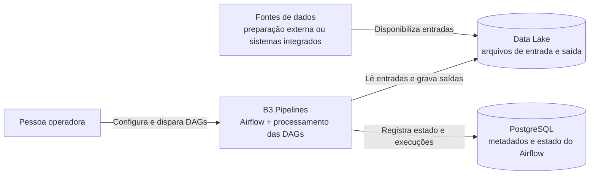
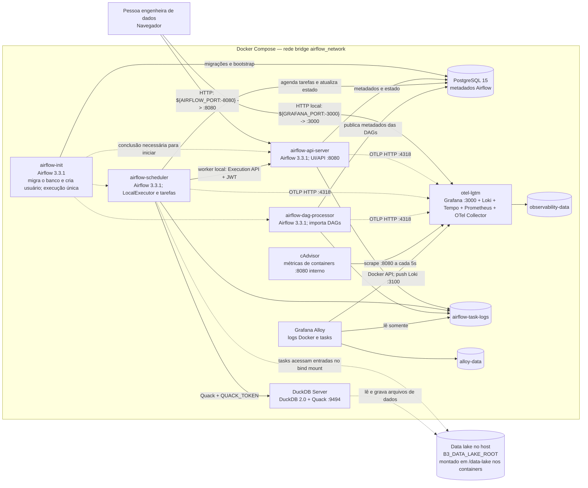

# B3 Pipelines

## Descrição e objetivo

B3 Pipelines é a base de execução e operação de pipelines de dados da B3. Ela
reúne orquestração, processamento analítico e armazenamento em arquivos para
que cada pipeline implemente seu próprio fluxo, suas regras de negócio e seus
contratos de entrada e saída.

O objetivo do repositório é oferecer uma stack local reproduzível, extensível e
observável para processar dados preparados no Data Lake. Hoje há uma pipeline
implementada: **série histórica de cotações COTAHIST**. As decisões e regras
específicas dela estão na [documentação da DAG](docs/historical-series/index.md).

## Escopo da plataforma

Em termos gerais, uma pipeline deste projeto pode validar uma entrada
disponível, transformá-la com DuckDB, registrar metadados de execução e
persistir resultados Parquet no Data Lake. As etapas e garantias concretas são
definidas por cada DAG; não se presume que todas as pipelines executem o mesmo
fluxo.

A plataforma fornece os serviços compartilhados de Airflow, PostgreSQL para
metadados do Airflow e DuckDB/Quack para processamento remoto. Os dados são
mantidos em arquivos no diretório do host montado nos containers em
`/data-lake`.

### O que a plataforma não é

- Não baixa nem recebe automaticamente dados de sistemas externos: a
  aquisição e preparação da entrada pertencem à fonte ou à pipeline.
- Não é um produto analítico pronto, dashboard, API de negócio ou catálogo de
  dados.
- Não implementa por padrão uma camada Gold nem métricas de negócio; novas
  pipelines podem introduzir essas saídas se houver requisitos.
- Não é um cluster distribuído ou de alta disponibilidade: o Compose usa
  `LocalExecutor` e uma única instância DuckDB/Quack.
- Não define uma agenda universal para os dados; agendamento, execução manual
  e parâmetros são responsabilidade de cada DAG.

## Fluxo funcional da plataforma

O fluxo abaixo é uma visão geral das responsabilidades, não um contrato que
substitui o fluxo documentado por cada DAG:

1. A pessoa operadora prepara ou disponibiliza a entrada no Data Lake.
2. Airflow inicia uma pipeline manualmente ou conforme a agenda definida por
   ela.
3. As tasks aplicam validações e transformações implementadas pela pipeline.
4. DuckDB processa os dados e grava as saídas configuradas no Data Lake.
5. Airflow registra o estado e os logs da execução para acompanhamento.

Para a topologia, comunicação entre containers, autenticação, persistência e
variáveis de ambiente, consulte [docs/infraestrutura.md](docs/infraestrutura.md).

## Visão arquitetural (C4)

Os diagramas Mermaid mostram o contexto (C1) e os containers (C2). A
configuração detalhada da infraestrutura está em
[docs/infraestrutura.md](docs/infraestrutura.md).

### C1 — Contexto da plataforma



### C2 — Containers e relações



## Stack utilizada

| Tecnologia | Uso |
|---|---|
| Python 3.12 | Airflow, DAGs, tasks Python e cliente DuckDB |
| Python 3.15 | DuckDB Server e processamento analítico |
| Apache Airflow 3.3.1 | API/UI, agendamento e processamento das tarefas |
| `LocalExecutor` | Execução local das tarefas do Airflow |
| DuckDB 2.0.0 | Motor analítico e processamento de arquivos |
| Quack | Protocolo HTTP interno entre clientes Python DuckDB e o servidor |
| PostgreSQL 15 | Banco de metadados persistente do Airflow |
| Docker Compose | Orquestração do ambiente local |
| Parquet + compressão ZSTD | Formato de saída das pipelines que o configuram |
| Volume local montado pelo Docker | Data Lake persistente compartilhado pelos serviços |

O Python API é usado como interface cliente; SQL permanece no DuckDB. O
servidor é uma única instância e suas configurações de memória e threads são
globais, compartilhadas pelas tasks. Ajuste concorrência, threads e memória
em conjunto, considerando os recursos alocados ao Docker Desktop e o acesso
ao volume compartilhado.

## Data Lake

O caminho persistente no host é definido por `B3_DATA_LAKE_ROOT`; no Compose,
ele é montado nos containers como `/data-lake`. Os diretórios abaixo ilustram
uma convenção geral de organização — nomes de datasets, partições e formatos
dependem de cada pipeline:

```text
<B3_DATA_LAKE_ROOT>/
├── raw/       # entradas originais preparadas para processamento
├── bronze/    # dados brutos estruturados e metadados técnicos
├── silver/    # dados tipados/validados, quando definidos pela pipeline
└── gold/      # reservado a produtos agregados futuros; não implementado hoje
```

O volume nomeado `postgres-db-volume` é separado do data lake e preserva o
banco do Airflow entre reinicializações. `docker compose down` não o remove;
`docker compose down -v` o apaga.

## Setup

Para configurar as variáveis e credenciais, entender a rede e os volumes, e
operar os serviços, consulte os capítulos
[`.env` e configuração](docs/infraestrutura.md#env-configuracao),
[containers e rede](docs/infraestrutura.md#containers-rede),
[volumes e persistência](docs/infraestrutura.md#volumes) e
[autenticação](docs/infraestrutura.md#autenticacao).

### Requisitos

- Docker Engine ou Docker Desktop com Docker Compose v2 e recursos suficientes
  para as pipelines que serão executadas.
- Python 3 no host para executar o launcher.
- Diretório persistente do Data Lake montado e acessível ao Docker.

### Configuração de ambiente

O significado e o destino de cada variável estão em
[`.env`: carregamento, variáveis e exemplos](docs/infraestrutura.md#env-configuracao).

Dentro de `B3-Pipelines`, `.env` é local e não deve ser versionado:

```sh
cd B3-Pipelines
cp .env.example .env
```

Se `.env` já existir, preserve-o e edite somente as variáveis necessárias.
Configure `B3_DATA_LAKE_ROOT` com o caminho absoluto do diretório persistente
visível ao Docker. Ajuste `AIRFLOW_UID` para o UID do usuário no Linux/WSL
quando necessário (por exemplo, o resultado de `id -u`).

`AIRFLOW_BASE_IMAGE` e `DUCKDB_BASE_IMAGE` definem as imagens base dos
Dockerfiles correspondentes e são passadas como argumentos de build pelo
Compose. Mantenha versões compatíveis com a combinação testada.
`AIRFLOW__CORE__EXECUTION_API_SERVER_URL` deve usar o nome do serviço na rede
Docker (`airflow-api-server`), não `localhost`, para que o scheduler alcance a
API de execução.
Se `AIRFLOW_PORT` estiver exportada no shell que inicia o launcher, ela
prevalece sobre o valor do `.env`.

Gere quatro valores aleatórios distintos para senhas, token e chave JWT; copie
cada resultado para sua variável no `.env`, sem reutilizar o mesmo valor:

```sh
python3 -c "import secrets; print(secrets.token_urlsafe(32))"
python3 -c "import secrets; print(secrets.token_urlsafe(32))"
python3 -c "import secrets; print(secrets.token_urlsafe(48))"
python3 -c "import secrets; print(secrets.token_urlsafe(64))"
```

Preencha:

```dotenv
AIRFLOW_DB_PASSWORD=<primeiro valor>
AIRFLOW_ADMIN_USERNAME=admin
AIRFLOW_ADMIN_PASSWORD=<segundo valor>
QUACK_TOKEN=<terceiro valor>
AIRFLOW__API_AUTH__JWT_SECRET=<quarto valor>
```

`AIRFLOW_DB_PASSWORD` deve permanecer compatível com URL. Os valores gerados
por `token_urlsafe` atendem a esse requisito. A chave JWT precisa ser idêntica
no scheduler e no API server para autenticar as tasks. Restrinja as permissões
do arquivo local:

```sh
chmod 600 .env
```

O volume PostgreSQL preserva a senha já inicializada; mudar
`AIRFLOW_DB_PASSWORD` no `.env` não altera automaticamente a senha dentro desse
banco. Faça a rotação do usuário no PostgreSQL antes de alterar esse valor em
um ambiente existente.

### Subir e conferir

Para detalhes de DNS, portas, dependências e saúde dos serviços, consulte
[containers, rede e comunicação](docs/infraestrutura.md#containers-rede) e
[operação e diagnóstico](docs/infraestrutura.md#operacao).

Na pasta `B3-Pipelines`, depois de configurar o `.env`, execute:

```sh
./start.sh
```

O launcher valida a configuração do Compose, constrói e inicia PostgreSQL,
DuckDB/Quack, Airflow e a stack de observabilidade, e aguarda o endpoint de
saúde do Airflow. Ele não abre o navegador: ao concluir, imprime as URLs do
Airflow, da pipeline COTAHIST, do Grafana e do Grafana Explore. O Grafana
centraliza os gráficos, logs e traces; sua porta pode ser configurada por
`GRAFANA_PORT` (padrão `3000`). A lista de DAGs e seus parâmetros depende das
pipelines instaladas.

Para iniciar a stack manualmente, use:

```sh
docker compose config --quiet
docker compose up --build -d
docker compose ps
# Substitua 8080 pelo AIRFLOW_PORT se ele foi personalizado.
curl --fail http://localhost:8080/api/v2/monitor/health
```

O Airflow fica disponível em `http://localhost:8080` (ou na porta definida por
`AIRFLOW_PORT`). Entre com `AIRFLOW_ADMIN_USERNAME` e
`AIRFLOW_ADMIN_PASSWORD`. Para parar os serviços sem apagar os dados, execute
na pasta `B3-Pipelines`:

```sh
./stop.sh
```

### Operação e exemplos

```sh
# Consultar estado e logs dos serviços compartilhados
docker compose ps
docker compose logs --tail=100 airflow-api-server airflow-scheduler \
  airflow-dag-processor duckdb-server

# Conferir DAGs carregadas e erros de importação
docker compose exec airflow-dag-processor airflow dags list
docker compose exec airflow-dag-processor \
  airflow dags list-import-errors --output json

# Consultar usuários do Airflow
docker compose exec airflow-api-server airflow users list

# Parar os serviços mantendo os dados persistentes
./stop.sh
```

Para executar uma DAG, consulte os parâmetros, pré-requisitos e passos de
operação documentados para aquela pipeline. A
[pipeline COTAHIST](docs/historical-series/index.md) é o exemplo atualmente
implementado.

### Execução local sem Compose

O pacote pode ser instalado em ambiente virtual para desenvolvimento e testes.
O modo de execução sem Compose, os comandos de entrada e os caminhos válidos
dependem da pipeline e devem ser seguidos na documentação dela. Para executar a
stack Airflow com DuckDB remoto, use o Compose conforme as instruções acima.

### Testes

Instale as dependências de teste e execute a suíte com cobertura de todo o
código Python em `src/`:

```sh
python -m pip install -e '.[test]'
PYTHONPATH=src coverage run -m unittest discover -s tests -t . -p 'test_*.py' -v
coverage report --fail-under=100
python -m compileall -q src airflow/dags duckdb-server
```

## Segurança e operação

- A topologia, as credenciais e os limites entre serviços estão detalhados em
  [Autenticação e limites de segurança](docs/infraestrutura.md#autenticacao).
- O mapeamento atual da porta Airflow não restringe o bind ao loopback; proteja
  o acesso com firewall ou restrinja o bind se a UI for somente local.
- A análise das decisões, diferenças entre a arquitetura anterior e a atual,
  relação com os recursos do DuckDB 2.0, validações e limites de performance
  está em [DuckDB Server e DuckDB 2.0](./docs/duckdb-server-2.0.md).
- As hipóteses priorizadas para a próxima rodada de performance, com
  experimentos, métricas e critérios de decisão, estão em
  [Hipóteses de melhorias futuras](./docs/hipoteses-melhorias-performance.md).
- A stack local de Grafana LGTM, métricas cAdvisor, logs Docker e
  instrumentação OpenTelemetry do Airflow está descrita em
  [Observabilidade](./docs/observabilidade.md).
- `.env` contém credenciais locais e está ignorado pelo Git; não publique seus
  valores.
- Quack autentica com token, mas as conexões não usam TLS. A porta `9494` não
  é publicada no host; a rede bridge também permite saída dos containers.
- Não exponha essa rede ou o serviço DuckDB diretamente. Para acesso externo,
  use um proxy reverso com TLS e aplique as recomendações da
  [documentação de segurança Quack](https://duckdb.org/docs/2.0/quack/security)
  e da [receita de proxy reverso](https://duckdb.org/docs/2.0/quack/setup/reverse_proxy).
- O token autentica clientes, mas não substitui isolamento de rede nem limita
  o SQL que um cliente autorizado pode executar.
- O servidor DuckDB é único; o Data Lake é persistido no diretório do host e
  os metadados do Airflow no volume Docker do PostgreSQL. Faça backup de ambos
  de acordo com a política do ambiente.
- A documentação específica da pipeline atual está organizada em
  [docs/historical-series/](docs/historical-series/index.md).
