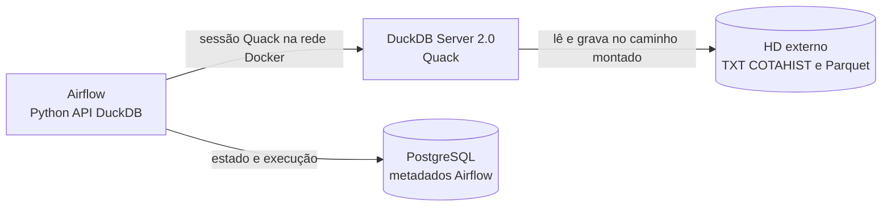

# DuckDB Server e DuckDB 2.0 no B3 Pipelines

## Resumo

O projeto passou de conexões DuckDB embutidas nos processos clientes para uma
instância DuckDB central, executada em container próprio e acessada por Airflow
via Quack. A versão do cliente e do servidor é fixada em `duckdb==2.0.0`.

Essa mudança separa a orquestração do processamento analítico e permite que
DuckDB leia e grave diretamente no data lake montado no HD externo, sem
materializar o conjunto de dados no processo Python. O SQL, as operações de
leitura e as escritas Parquet continuam sendo executados pelo motor DuckDB.

O que foi verificado é o funcionamento e a integração dessa arquitetura. Não
foi executado benchmark comparativo contra a configuração anterior; portanto,
este documento não afirma um percentual de aceleração.

## Arquitetura depois da mudança

O volume do data lake é montado nos containers Airflow e DuckDB no mesmo
caminho `/data-lake`. As operações de transformação são executadas pelo
servidor, que acessa os arquivos nesse mount. O PostgreSQL permanece dedicado
aos metadados do Airflow.

## Antes e depois

| Aspecto | Antes | Depois |
|---|---|---|
| Instância DuckDB | Conexões embutidas criadas pelos processos que executavam cada etapa. | Um serviço DuckDB/Quack persistente, separado do Airflow. |
| Comunicação | A execução dependia da instância DuckDB local ao processo. | O cliente Python conecta ao servidor pela rede interna do Compose. |
| Responsabilidade dos containers | A orquestração e a execução DuckDB ficavam acopladas aos processos Airflow. | Airflow coordena as tarefas; DuckDB executa consultas e I/O analítico em seu próprio container. |
| Acesso ao data lake | O processamento usava caminhos disponíveis ao processo local. | O mount do HD externo é compartilhado entre Airflow e DuckDB, e o servidor lê/grava diretamente em `/data-lake`. |
| Configuração de recursos | Cada conexão local podia receber configurações próprias de memória e threads. | Memória, threads e preservação da ordem de inserção são configurações globais da instância Quack e são definidas no servidor. |
| Interface Python/SQL | O código usava a API Python para conectar e executar SQL. | Continua usando a API Python como cliente; o SQL e o processamento continuam no motor DuckDB, agora remoto. |
| Parâmetros SQL | A API aceitava o uso pretendido de parâmetros pelo cliente. | O protocolo Quack usado no projeto não aceita parâmetros nomeados passados a `execute(query, params)`; `execute_query` os renderiza como literais SQL com escaping e validação. |
| Dependência DuckDB | A versão podia não estar coordenada entre componentes. | `duckdb==2.0.0` é declarada no `pyproject.toml` e usada nos containers cliente e servidor. |
| Inicialização | Não havia um serviço remoto persistente validado pela stack. | Compose inicia, verifica e conecta o serviço Quack; a porta fica interna à rede Docker. |

O “antes” descreve a arquitetura anterior à separação registrada neste projeto,
não uma medição de desempenho.

## Melhorias, motivos e ganhos

### 1. DuckDB em um serviço dedicado com Quack

**Antes:** as etapas usavam instâncias embutidas nos processos clientes.

**Depois:** um processo DuckDB persistente serve conexões clientes pelo
protocolo Quack na rede privada do Compose.

**Motivo:** separar o ciclo de vida do motor analítico do Airflow e oferecer um
ponto de execução consistente para as tarefas, sem mover o processamento para
Python.

**Ganhos:**

- Isolamento operacional entre orquestração e motor de consultas.
- Um único conjunto de limites globais de recursos para a instância.
- Acesso remoto pelo cliente oficial DuckDB para Python.
- Possibilidade de vários clientes utilizarem o mesmo serviço, sujeita aos
  limites de recursos e concorrência da instância única.

Quack não transforma esta instalação em cluster distribuído nem em serviço de
alta disponibilidade: há um único servidor DuckDB.

### 2. DuckDB 2.0.0 fixado entre cliente e servidor

**Antes:** versões de DuckDB podiam divergir entre os ambientes de execução.

**Depois:** a dependência base do projeto é fixada em `duckdb==2.0.0`; tanto o
cliente Airflow quanto a imagem do servidor são instalados a partir do
`pyproject.toml`.

**Motivo:** manter compatíveis o cliente, o servidor e a extensão Quack, e
reduzir diferenças entre ambientes.

**Ganhos:**

- Versão reproduzível nos builds do projeto.
- Uso do Quack em sua versão aprimorada no DuckDB 2.0.
- Compatibilidade com as instruções `CONNECT` e `DISCONNECT` adicionadas ao SQL
  do DuckDB 2.0. O cliente do projeto usa `ATTACH` e `CONNECT`; o encerramento
  da conexão é feito pela API Python, não pela instrução SQL `DISCONNECT`.

A documentação oficial esclarece que Quack já podia executar DuckDB como
servidor desde a versão 1.5.3. Portanto, a separação por servidor não é
apresentada aqui como uma funcionalidade criada exclusivamente no 2.0: a versão
2.0 entrega uma versão mais polida da extensão e as instruções SQL novas.

### 3. API Python como cliente, SQL executado no DuckDB

**Antes e depois:** a API Python permanece a interface usada pelo código para
abrir conexões e submeter comandos; as consultas de transformação não foram
convertidas em loops ou processamento linha a linha em Python.

**Motivo:** manter integração Python com Airflow sem perder o processamento
vetorizado do motor DuckDB.

**Ganhos esperados:**

- Python coordena conexões e tarefas sem trazer todos os registros para a
  memória do worker.
- `read_csv`, `read_parquet`, `COPY`, filtros, deduplicação e escrita Parquet
  continuam no motor DuckDB.
- O custo do protocolo remoto é principalmente o da comunicação e gestão de
  sessões; não substitui a execução do SQL pelo cliente Python.

O uso da API Python, por si só, não determina uma perda de performance. A
materialização de resultados grandes com `fetchall()` ou a transformação
registro a registro no processo cliente pode aumentar uso de memória e custo de
CPU; o caminho de carga do pipeline evita esse padrão.

### 4. Execução direta sobre o HD externo

**Antes:** a separação dos serviços ainda não estava conectada a um caminho
compartilhado validado pelo Compose.

**Depois:** o diretório definido por `B3_DATA_LAKE_ROOT` no host é montado como
`/data-lake` nos containers Airflow e DuckDB.

**Motivo:** preservar os dados existentes no HD externo e evitar cópias
intermediárias para o filesystem efêmero dos containers.

**Ganhos:**

- Os arquivos RAW continuam no HD externo.
- Os Parquets Bronze e Silver continuam sendo gravados no caminho do HD
  externo.
- DuckDB lê e grava arquivos nesse caminho diretamente; PostgreSQL não
  armazena as cotações.

O desempenho físico ainda depende do HD, do filesystem, da conexão e da
configuração de I/O do Docker Desktop. O compartilhamento do mount não garante
por si só que o disco externo tenha a mesma taxa de leitura/escrita de um SSD
local.

### 5. Limites globais e concorrência explícitos

**Antes:** limites podiam ser passados a conexões individuais, embora isso não
represente limites isolados quando os clientes compartilham uma instância
remota.

**Depois:** o servidor define `DUCKDB_MEMORY_LIMIT`, `DUCKDB_THREADS` e
`DUCKDB_PRESERVE_INSERTION_ORDER` uma vez. O cliente rejeita overrides remotos
divergentes. A carga Bronze distingue entre modo local (divide threads entre
workers) e modo Quack (threads pertencem à instância global).

**Motivo:** evitar configurações contraditórias e interpretações incorretas
dos limites em conexões remotas concorrentes.

**Ganhos:**

- Configuração centralizada e reproduzível.
- Erros de incompatibilidade identificados no cliente, em vez de mudanças
  silenciosas por tarefa.
- Logs distinguem threads globais no servidor e threads por worker no modo
  local.

**Limite operacional:** a configuração global não reserva um orçamento de
threads para cada cliente. A concorrência de tarefas, workers Bronze e
consultas pode competir pelos mesmos recursos. Ajuste concorrência, threads e
memória juntos, considerando os recursos alocados ao Docker.

Na execução manual, Bronze pode usar `BRONZE_MAX_WORKERS`; na DAG, o código
passa `max_workers=1` a cada tarefa anual. O mapeamento de anos ainda pode
executar tarefas em paralelo, de modo que a concorrência total também depende
do Airflow.

### 6. Compatibilidade de parâmetros no cliente Quack

**Antes:** os comandos usavam parâmetros nomeados via Python DB API como se o
transporte remoto suportasse `execute(query, params)`.

**Depois:** `execute_query` reconhece marcadores `$nome`, serializa valores
compatíveis como literais SQL escapados e não substitui marcadores encontrados
em strings ou comentários. A função também detecta parâmetros ausentes ou não
utilizados e tipos não suportados.

**Motivo:** superar a incompatibilidade identificada no teste real do protocolo
Quack, mantendo a API cliente Python e sem transferir conjuntos de dados para
Python.

**Ganhos:** consultas parametrizadas do projeto passam a funcionar no serviço
remoto, com tratamento explícito de valores em vez de interpolação ingênua.

Como a solução renderiza valores no texto SQL, ela não deve ser confundida com
parâmetros binários/preparados enviados pelo driver. Novos tipos ou consultas
devem passar pelos testes da função de renderização.

### 7. Inicialização e isolamento operacional

**Antes:** os problemas de inicialização e de conectividade observados durante
a validação impediam uma stack funcional.

**Depois:** Compose constrói um container específico do servidor, configura
token e limites, espera o healthcheck antes de liberar os serviços Airflow e
mantém a porta Quack acessível somente na rede interna do Compose.

**Ganhos:**

- Falha de disponibilidade detectada por healthcheck e dependências explícitas
  dos serviços.
- Sem publicação da porta Quack diretamente no host.
- Redução de instalação manual e de divergência entre ambientes, com
  dependências declaradas no projeto.

Quack está configurado sem TLS apenas na rede interna privada do Compose. O
token autentica clientes, mas não limita o SQL que um cliente autorizado pode
executar. Acesso externo exige proxy reverso com TLS e controles adicionais.

## Funcionalidades do DuckDB 2.0: escopo deste projeto

A página oficial “What's New in the Docs for 2.0” descreve diversas
funcionalidades. Este projeto adota a versão 2.0, mas não usa automaticamente
toda funcionalidade nova da versão.

| Tema do DuckDB 2.0 | Relação com este projeto |
|---|---|
| Extensão Quack aprimorada e `CONNECT`/`DISCONNECT` | Quack e `CONNECT` são usados pelo servidor/cliente; `DISCONNECT` está disponível no DuckDB 2.0, mas não é usado diretamente pelo código do projeto. |
| `VARIANT`, triggers, novos joins, CTEs modificadoras, schemas aninhados, `SECURE VIEW` e outras extensões de SQL | Não adotados nas transformações atuais; não são apresentados como ganhos desta migração. |
| I/O assíncrono e read-ahead | Não há benchmark nem configuração específica documentada para provar ganho no HD externo. A documentação destaca cenário de object storage; não se deve inferir aceleração do disco local/external mount sem medições. |
| Melhorias do otimizador e poda de row groups | Podem beneficiar consultas elegíveis, mas não foram isoladas nem quantificadas neste projeto. |
| Novo formato de armazenamento interno DuckDB 2.0 | O servidor usa uma instância `:memory:`; as camadas do lake são arquivos Parquet. Não é uma migração do formato de banco persistente DuckDB. |
| Novo parser SQL, C API v2, appender Python e custom partition paths | Não são dependências explícitas do fluxo documentado; não são ganhos reivindicados aqui. |

O formato de saída do pipeline é Parquet e é controlado pelas consultas `COPY`
e configurações existentes, como compressão ZSTD, tamanho de row group e
particionamento. O formato de armazenamento interno padrão do DuckDB 2.0 não
deve ser confundido com o formato Parquet do data lake.

## Verificação e ganhos comprovados

As seguintes verificações foram executadas no ambiente local:

- Build e inicialização de Airflow, PostgreSQL e DuckDB/Quack pelo Docker
  Compose; DuckDB e PostgreSQL ficaram saudáveis.
- DAG registrada no Airflow sem erros de importação.
- Consulta remota ao Quack e validação do modo local DuckDB.
- Fluxo sintético de dois anos, com dois workers Bronze remotos: RAW →
  Bronze → qualidade Bronze → Silver.
- Cinco testes unitários de parâmetros SQL, compilação Python, verificação do
  Compose e `git diff --check`.
- Dados sintéticos removidos ao fim do teste; o volume PostgreSQL foi
  preservado.

O teste sintético comprova interoperabilidade e processamento concorrente
funcional, não throughput de produção. Ele usou uma linha por ano e não mede
tempo de execução, uso máximo de memória, escalabilidade ou comparação entre
Quack e DuckDB embutido.

Para quantificar performance, é necessário um benchmark controlado com os
mesmos arquivos COTAHIST, hardware, Docker resource limits, número de threads,
concorrência, cache e destino. Registre duração total e por etapa, throughput,
CPU, memória, I/O do disco e tamanho dos Parquets; compare repetições em
condições equivalentes. O teste não deve sobrescrever partições reais.

## Referências

- [What's New in the Docs for DuckDB 2.0](https://duckdb.org/docs/2.0/whats_new_in_the_docs)
- [DuckDB Quack](https://duckdb.org/docs/2.0/quack/overview)
- [Quack Setup](https://duckdb.org/docs/2.0/quack/setup/overview)
- [Securing Quack with a Reverse Proxy](https://duckdb.org/docs/2.0/quack/setup/reverse_proxy)
- [DuckDB Python API](https://duckdb.org/docs/2.0/clients/python/overview)
- [Data Ingestion](https://duckdb.org/docs/2.0/clients/python/data_ingestion)
- [Conversion between DuckDB and Python](https://duckdb.org/docs/2.0/clients/python/conversion)
- [DuckDB Python DB API](https://duckdb.org/docs/2.0/clients/python/dbapi)
- [Compose](../docker-compose.yml), [DuckDB server](../duckdb-server/server.py),
  [DuckDB client](../src/utils/duckdb_connection.py) e
  [dependências](../pyproject.toml).
