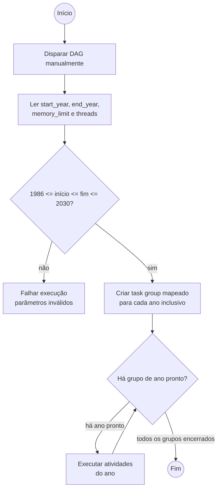
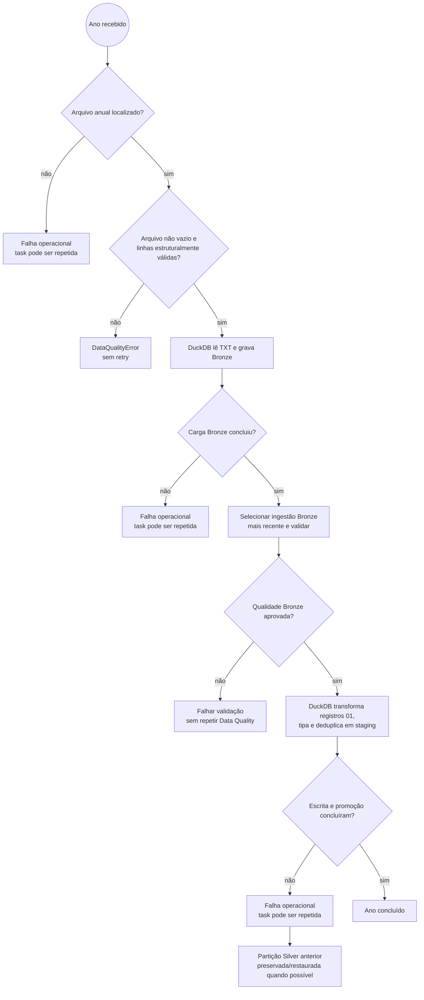

# Diagramas de atividades — `historical-series`

## Disparo e mapeamento por ano

**Leitura:** o intervalo gera uma atividade independente por ano. O Airflow
limita a execução total pela configuração `BRONZE_MAX_WORKERS` e não inicia
uma segunda execução da DAG enquanto a primeira estiver ativa. Um erro em um
grupo não cria dependência entre anos diferentes.

## Atividades de um ano

**Leitura:** falhas de Data Quality RAW e Bronze são convertidas para
`AirflowFailException`, portanto não recebem retry. A ausência do arquivo RAW
gera erro operacional e segue a política padrão da DAG (uma nova tentativa
após três minutos), assim como outras falhas operacionais. Silver prepara
uma saída em staging e promove somente a partição do ano; a proteção/restauração
refere-se à implementação de promoção, não a uma transação do Data Lake
inteiro.
