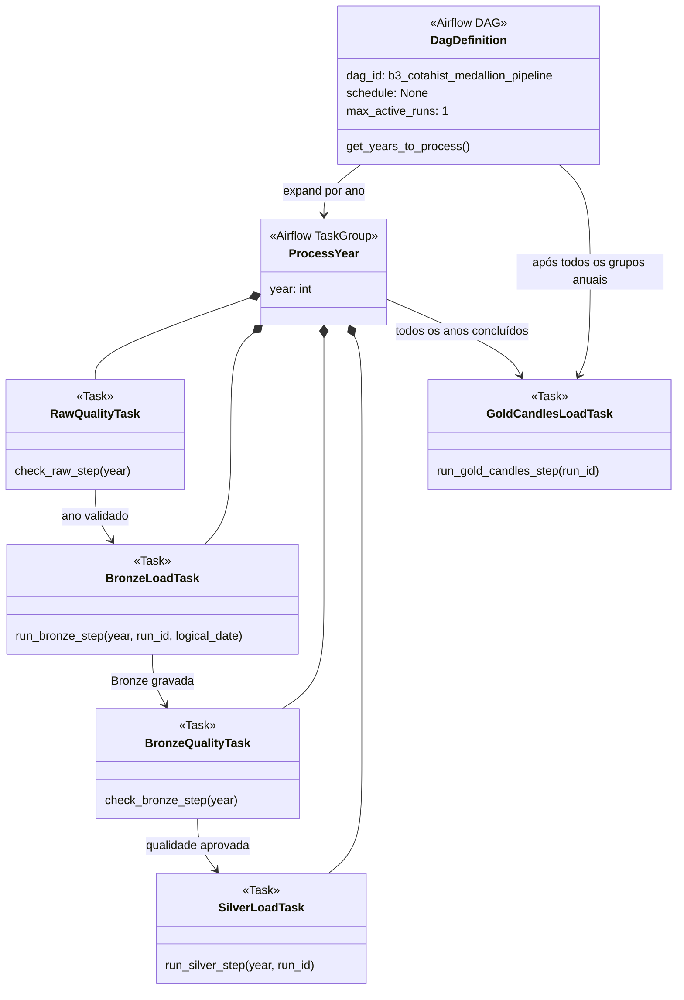
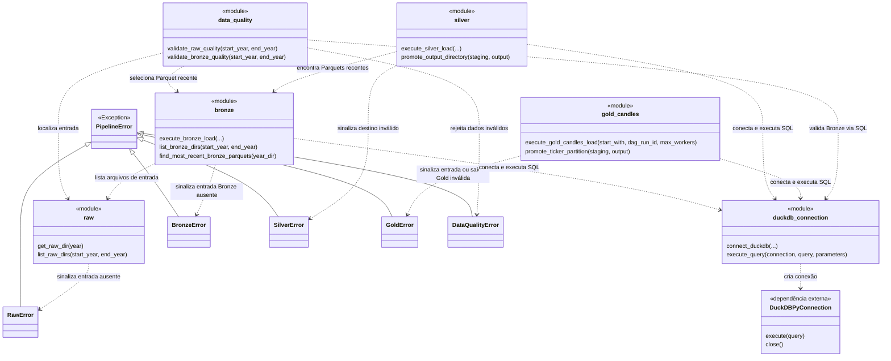

# Diagramas de classes — `historical-series`

## Orquestração e etapas da DAG

A DAG não implementa classes de domínio próprias: ela é declarada com
decoradores Airflow e compõe funções/tasks aninhadas. O diagrama abaixo usa
caixas UML como representação conceitual dos elementos executáveis e suas
responsabilidades; não afirma que `TaskGroup` ou as tasks sejam classes Python
definidas pelo projeto.

**Leitura:** `get_years_to_process` produz a lista de anos inclusiva e
`process_year.expand` cria a execução mapeada por ano. Dentro de cada grupo, a
dependência ordena RAW, carga Bronze, qualidade Bronze e carga Silver. Não há
dependência entre grupos de anos distintos. Após todos os grupos, a task Gold
gera o produto de candles.

## Módulos, serviços e exceções

Este diagrama apresenta módulos como unidades de responsabilidade. Os métodos
listados são funções de módulo, não métodos de instâncias. As exceções são
classes Python reais; `DuckDBPyConnection` é uma dependência externa.
O diagrama destaca a hierarquia comum do projeto: além dela, `RawError` e
`BronzeError` herdam de `FileNotFoundError`, `SilverError` de
`NotADirectoryError` e `DataQualityError` de `ValueError`.

**Leitura:** a organização principal está em `historical_series.ingestions`,
`historical_series.data_qualities` e `historical_series.transformations`.
`utils.duckdb_connection` centraliza as conexões locais/remotas. A camada
`common.exceptions` fornece erros especializados para falhas RAW, Bronze,
Silver e Data Quality.

`GoldError` sinaliza falhas específicas da geração Gold de candles.
