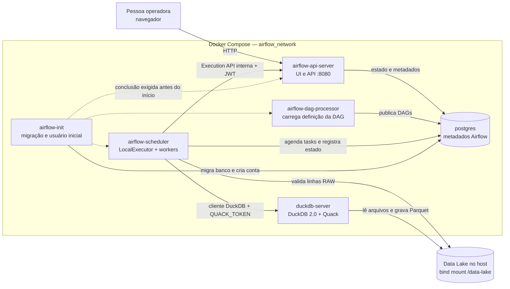
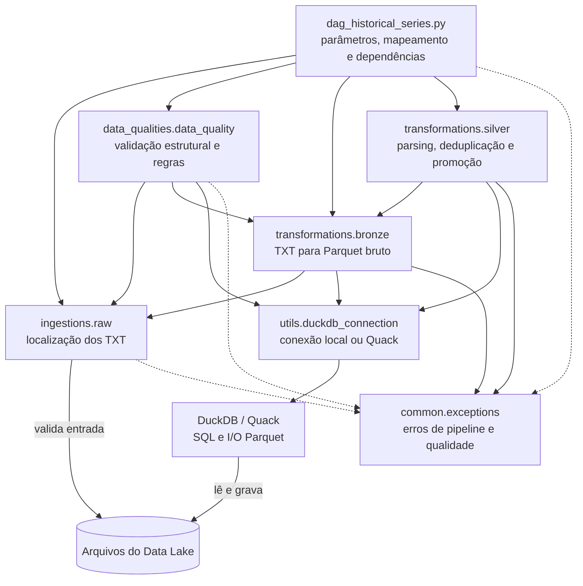

# Diagramas de componentes — `historical-series`

## Componentes de execução e infraestrutura

**Leitura:** o `LocalExecutor` executa os workers dentro do container
`airflow-scheduler`; não há serviço worker dedicado. API, scheduler, DAG
processor, PostgreSQL e DuckDB/Quack comunicam-se pela rede Compose. O volume
do Data Lake é compartilhado pelo scheduler e pelo servidor DuckDB; o
PostgreSQL guarda estado e metadados, não as cotações.

## Componentes de software da pipeline

**Leitura:** Airflow aciona as funções de domínio e controla as dependências.
Validação RAW acessa o arquivo no worker; consultas de conversão e validação
Bronze passam por DuckDB. O estágio Silver também usa staging e promoção da
partição no volume compartilhado.

Para os limites de rede, portas, autenticação e volumes, consulte
[infraestrutura](../infraestrutura.md).
