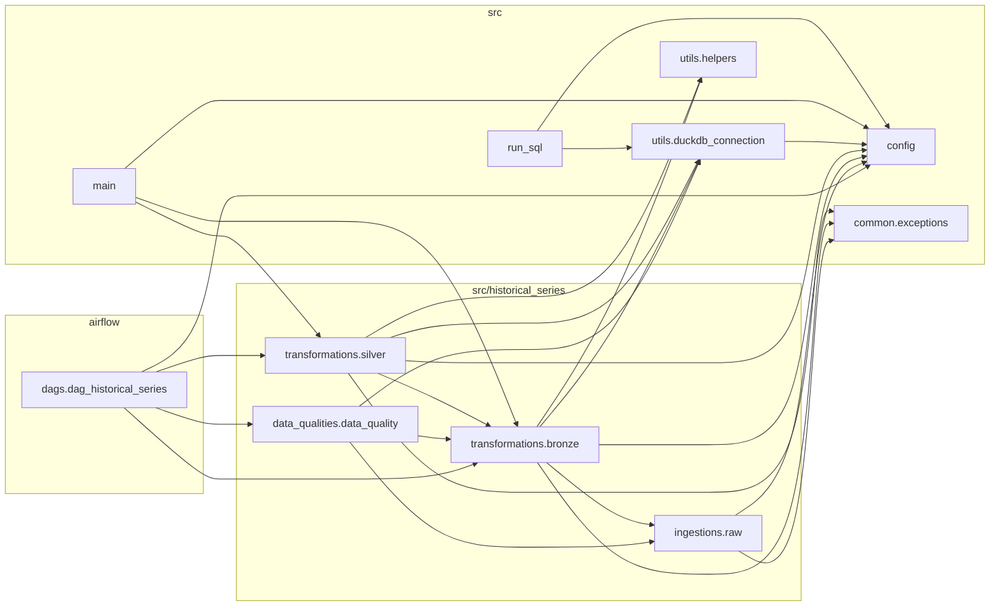

# Diagrama de pacotes — `historical-series`

## Organização e dependências Python

O diagrama representa pacotes e módulos do repositório como namespaces
agrupados. As setas indicam dependências de importação e uso, não o fluxo
temporal da execução.

**Leitura:** `historical_series` concentra as responsabilidades da série. O
módulo `config` fornece caminhos, limites de recursos e constantes posicionais
do layout. `common.exceptions` padroniza erros; `utils` concentra integração
DuckDB e validação de diretórios. `main` permite execução sequencial fora da
DAG e `run_sql` oferece uma interface interativa local para os Parquets.

`duckdb-server/server.py` é um processo de infraestrutura separado: usa a
configuração e inicia Quack, mas não é importado pelas transformações. Ele é
iniciado pelo Docker Compose.
