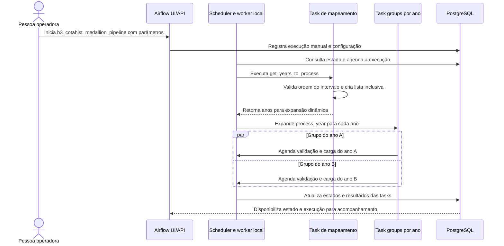
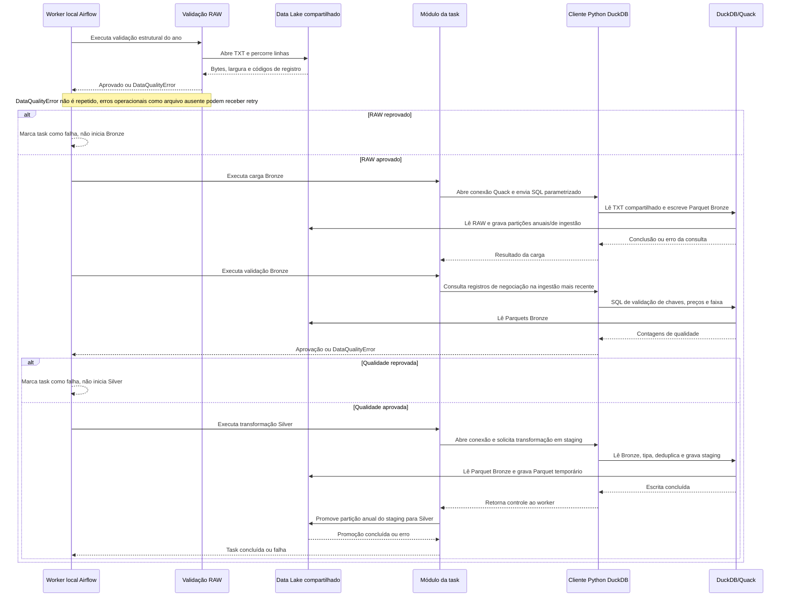

# Diagramas de sequência — `historical-series`

## Disparo e criação dos fluxos anuais

**Leitura:** a UI cria uma execução manual. O scheduler valida a faixa por
meio da task mapeadora e distribui grupos por ano sujeitos ao limite global de
tasks ativas. O desenho ilustra anos diferentes; não há dependência de dados
entre eles.

## Processamento de um ano

**Leitura:** validação RAW é feita pelo worker sobre o arquivo montado. As
consultas de carga, qualidade Bronze e transformação Silver são enviadas ao
servidor Quack, que acessa o mesmo Data Lake. A promoção de diretório Silver é
feita pelo código Python no volume compartilhado depois que a escrita de
staging termina.

Em erros operacionais, o Airflow pode repetir a task uma vez após três
minutos. Falhas de Data Quality não são repetidas. Para critérios e efeitos
detalhados, consulte [regras e requisitos](regras-requisitos.md).
