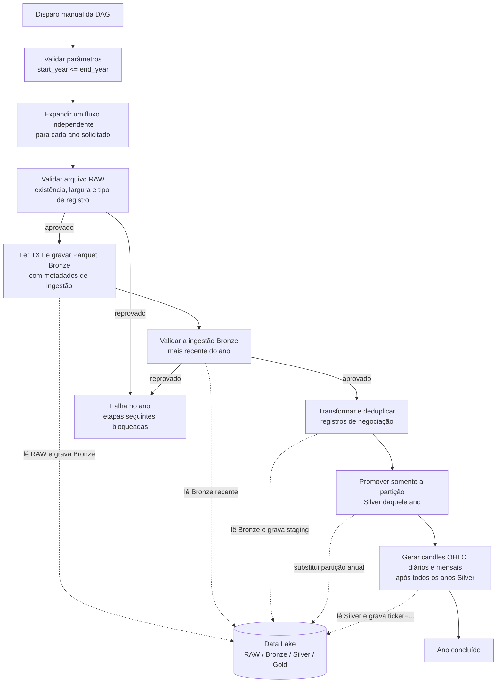
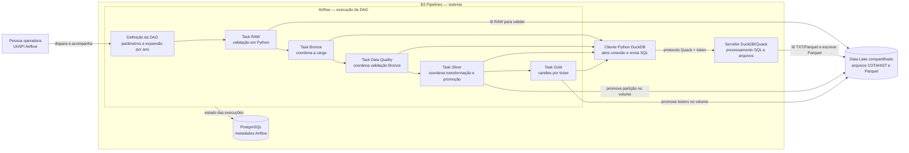

# DAG `historical-series` — série histórica da B3

> **Identificador no Airflow:** `b3_cotahist_medallion_pipeline`
>
> **Escopo:** arquivos anuais COTAHIST previamente disponibilizados no Data Lake.

## Descrição e objetivo

Esta DAG implementa o processamento da série histórica de cotações da B3 no
layout posicional COTAHIST. O objetivo é transformar TXT anual em dados
Parquet auditáveis nas camadas Bronze, Silver e Gold, com validações de qualidade
entre as etapas. Airflow coordena as tarefas; DuckDB executa as leituras,
transformações SQL e escritas Parquet.

A DAG é disparada manualmente (`schedule=None`). Cada ano do intervalo é
processado de forma independente; uma falha em um ano não bloqueia os demais,
embora possa fazer a execução global terminar com falha. O intervalo é
inclusivo e deve estar entre 1986 e 2030.

## O que faz

- Confirma a presença e valida a estrutura de cada arquivo RAW anual antes da
  ingestão.
- Converte cada TXT em registros brutos Parquet na Bronze, acrescentando
  metadados de execução e particionando por ano e instante de ingestão.
- Executa Data Quality sobre a ingestão Bronze mais recente do ano.
- Converte apenas registros de negociação para Silver tipada, deduplica por
  ativo, data de pregão e tipo de mercado, materializa a chave em `entity_id`
  e mantém linhagem.
- Processa os anos Silver em workers paralelos e substitui somente a partição
  Silver anual solicitada; se a escrita ou promoção falhar, tenta preservar ou
  restaurar a versão anterior.
- Gera candles OHLC diários (`timeframe = '1d'`) e mensais (`timeframe = '1m'`)
  na Gold, particionados por ticker, filtrando registros inconsistentes,
  filtrando por prefixos de ticker e distribuindo grupos de tickers entre
  workers paralelos.

## O que não faz

- Não baixa arquivos nem consulta uma API da B3. Os TXT devem estar disponíveis
  antes da execução.
- Não cria dashboard, API de consulta ou catálogo de dados. A Gold contém
  candles OHLC diários e mensais, não indicadores ou preços oficiais de
  fechamento.
- Não representa o preço oficial de fechamento do pregão: a coluna chamada
  `preco_fechamento` é extraída de `PREULT`, o preço do último negócio no
  layout COTAHIST.
- Não executa ingestões periódicas automaticamente nem permite mais de uma
  execução ativa da DAG.
- Não oferece tolerância a falhas de infraestrutura distribuída: o Compose
  atual usa `LocalExecutor` e uma instância compartilhada DuckDB/Quack.

## Entradas e saídas

Por padrão, para cada ano `AAAA`, espera o arquivo:

```text
/data-lake/raw/cotahist/ano=AAAA/COTAHIST_A{AAAA}.TXT
```

`{AAAA}` representa o ano com quatro dígitos; por exemplo, para 2024 o arquivo
é `COTAHIST_A2024.TXT`.

No Compose, `/data-lake` corresponde ao diretório do host configurado por
`B3_DATA_LAKE_ROOT`. Os caminhos podem ser sobrescritos por
`B3_RAW_COTAHIST_DIR`, `B3_BRONZE_COTAHIST_DIR` e
`B3_SILVER_COTAHIST_DIR` e `B3_GOLD_CANDLES_DIR`; no container, mantenha-os no
volume compartilhado.

```text
/data-lake/
├── raw/cotahist/ano=AAAA/COTAHIST_A{AAAA}.TXT
├── bronze/cotacoes_historicas/year=AAAA/_ingested_date=<timestamp>/*.parquet
├── silver/cotacoes_historicas/year=AAAA/*.parquet
└── gold/candles/ticker=VALE3/*.parquet
```

Bronze preserva uma coluna `content` com a linha COTAHIST e campos de
auditoria (`_ingested_at`, `_source_file`, `_dag_run_id`, `year` e
`_ingested_date`). Silver expõe os campos tipados de cotação, a coluna
`entity_id` (`TICKER|YYYY-MM-DD|MERCADO`) e a linhagem da execução, do
arquivo RAW e do Parquet Bronze. Gold expõe candles com `timeframe` (`1d` ou
`1m`), colunas OHLC, `volume_total` e metadados `_ingested_at` (horário da
carga, em UTC) e `_dag_run_id`; cada partição `ticker=<TICKER>/` contém o
histórico completo do ativo nos dois timeframes.

## DAG auxiliar — somente camada Gold

A DAG `b3_gold_candles` (`airflow/dags/dag_gold_candles.py`) executa apenas a
transformação `gold/candles` sobre o dataset Silver já consolidado, sem
repetir Bronze e Silver. É útil para reprocessar tickers ou corrigir a Gold
sem rerodar o pipeline completo. Aceita o mesmo seletor de ticker da DAG
principal — `start_with`, uma lista de prefixos separada por vírgula (vazio
processa todos) — além de `memory_limit`, `threads` e `max_workers`.

## Fluxo funcional

Airflow valida o intervalo solicitado e expande uma task group por ano. Para
cada ano, a validação RAW é uma barreira antes da gravação Bronze; a Data
Quality Bronze é outra barreira antes da Silver. Depois que todos os anos da
Silver terminam, a task Gold lê o dataset Silver completo e escreve as
partições por ticker solicitadas. DuckDB/Quack acessa o mesmo volume
compartilhado para ler e escrever arquivos. Falhas e tentativas são
descritas em [regras e requisitos](regras-requisitos.md).



## C4 — C3: componentes da DAG

O desenho usa `flowchart` para deixar explícitos sentidos e tipos diferentes
de relacionamento. O limite do sistema é a plataforma B3 Pipelines; as tasks
da DAG executam no worker local do scheduler, enquanto as operações analíticas
e de I/O são executadas pela instância DuckDB/Quack.



## Documentação por escopo

| Documento | Conteúdo |
|---|---|
| [Regras e requisitos](regras-requisitos.md) | Regras de negócio, requisitos funcionais e não funcionais, limites e parâmetros. |
| [Diagrama de classes](diagrama-classes.md) | Estrutura da DAG, funções/módulos e tipos de exceção relacionados. |
| [Diagrama de componentes](diagrama-componentes.md) | Responsabilidades e conexões entre componentes de execução. |
| [Diagrama de pacotes](diagrama-pacotes.md) | Organização dos módulos Python e suas dependências. |
| [Diagrama de atividades](diagrama-atividades.md) | Sequência de atividades e decisões por execução/ano. |
| [Diagrama de sequência](diagrama-sequencia.md) | Mensagens entre operador, Airflow, worker, DuckDB e Data Lake. |

Para setup e operação dos serviços compartilhados, consulte também
[infraestrutura](../infraestrutura.md) e a documentação de
[observabilidade](../observabilidade.md), que explica como consultar logs,
métricas e traces. A visão geral da plataforma está no
[README](../../README.md).
