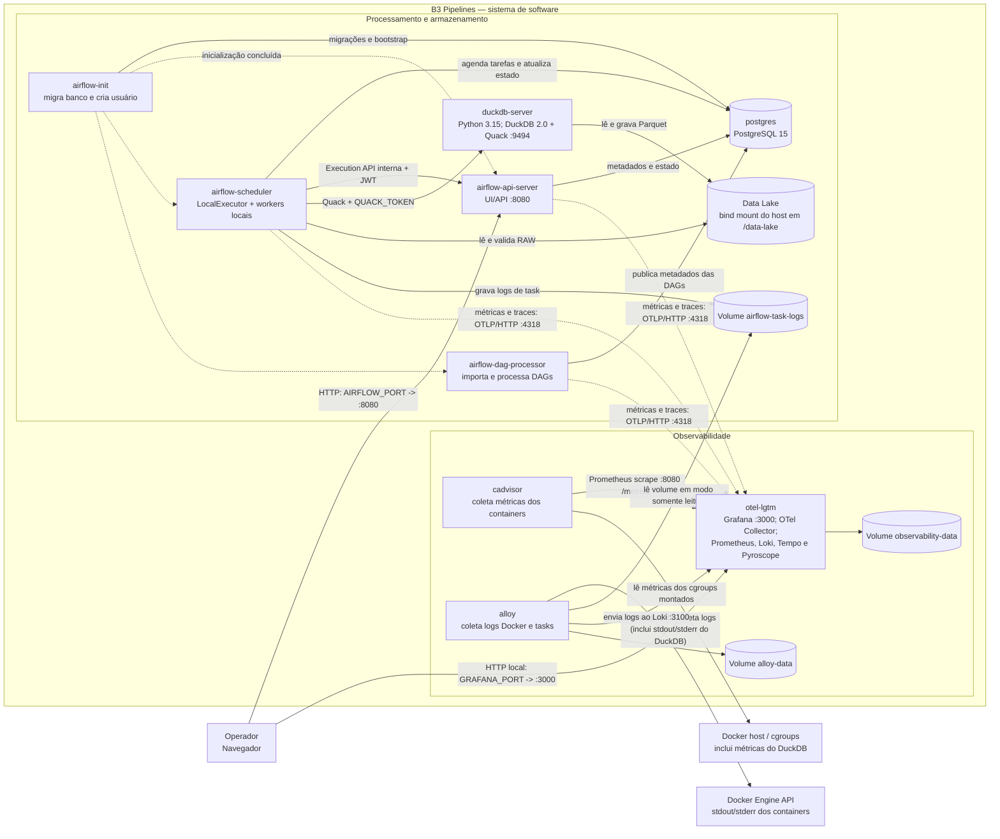
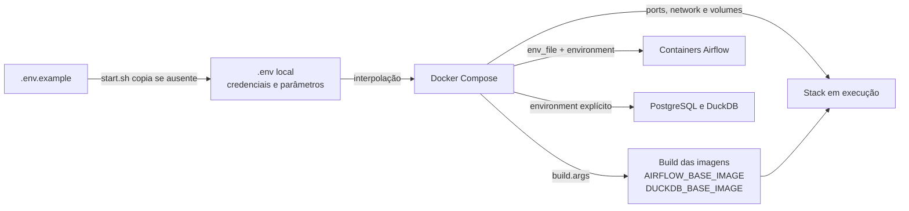

# Infraestrutura do B3 Pipelines

Este documento descreve como configurar, iniciar e operar a infraestrutura
local do B3 Pipelines: serviços e responsabilidades, rede Docker, autenticação,
volumes, variáveis de ambiente e diagnóstico.

O Compose é a fonte de verdade para os serviços e mounts: [docker-compose.yml](../docker-compose.yml).
Os valores de referência sem credenciais estão em [.env.example](../.env.example).

## Visão geral

O Docker Compose inicia o Airflow, o PostgreSQL de metadados, o servidor
DuckDB/Quack e os serviços locais de observabilidade. Os arquivos de cotação
permanecem no diretório do host definido por `B3_DATA_LAKE_ROOT`; não são
copiados para as imagens.

<a id="containers-rede"></a>
## Containers, rede e comunicação



Todos os containers Compose usam a rede `airflow_network` e se encontram pelos
nomes de serviço. A porta da UI é publicada no host como `${AIRFLOW_PORT:-8080}`
e encaminhada para `8080` no API server. Grafana é publicado somente em
`127.0.0.1:${GRAFANA_PORT:-3000}`. PostgreSQL (`5432`) e DuckDB/Quack
(`DUCKDB_PORT`, padrão `9494`) não são publicados no host; Quack é apenas
exposto à rede do projeto.

Os grupos internos do C2 separam responsabilidades dentro do sistema B3
Pipelines; não criam redes Docker isoladas. Todos os containers usam
`airflow_network`. O DuckDB Server não exporta OTLP diretamente: o cAdvisor
coleta métricas do container via cgroups e o Alloy coleta seu stdout/stderr
pela Docker Engine API.

O mapeamento atual do API server não fixa um endereço IP no host; por isso, o
Docker pode publicá-lo em todas as interfaces, não somente em `localhost`. A
UI usa HTTP sem TLS. Restrinja o acesso com firewall ou, se a UI for somente
local, altere o mapeamento para
`127.0.0.1:${AIRFLOW_PORT:-8080}:8080`.

`airflow_network` é uma bridge padrão, não uma rede com saída bloqueada. Em
uma instalação sem cache da extensão, `duckdb-server` precisa de acesso de
saída para executar `INSTALL quack` durante a inicialização.

O `LocalExecutor` executa os processos worker no próprio container
`airflow-scheduler`; não há um serviço worker separado. `airflow-init` migra o
banco e cria o usuário inicial, depois encerra.

| Serviço | Responsabilidade e conteúdo |
|---|---|
| `airflow-init` | Imagem `b3-airflow:local`; migra o banco e cria o usuário administrativo inicial; termina após concluir. |
| `airflow-api-server` | Airflow 3.3.1; UI, API e endpoint interno de execução; publica `8080` no host por `AIRFLOW_PORT`. |
| `airflow-scheduler` | Airflow 3.3.1 com `LocalExecutor`; agenda tasks e inicia workers locais. |
| `airflow-dag-processor` | Airflow 3.3.1; lê DAGs do bind mount `/opt/airflow/dags` e publica seus metadados. |
| `postgres` | PostgreSQL 15; metadados e estado do Airflow, persistidos em `postgres-db-volume`. |
| `duckdb-server` | Python 3.15, DuckDB 2.0 e Quack; executa SQL/I/O analítico na porta interna `DUCKDB_PORT`. |
| `otel-lgtm` | Imagem `grafana/otel-lgtm:0.41.1`; Grafana, OpenTelemetry Collector, Prometheus, Loki, Tempo e Pyroscope. Grafana publicado em `GRAFANA_PORT`; OTLP/Loki ficam internos à rede Compose. |
| `cadvisor` | Imagem `gcr.io/cadvisor/cadvisor:v0.55.1`; coleta métricas de CPU, memória, disco e rede dos containers/cgroups; endpoint `8080` somente interno, sem conflito com Airflow. No Docker Desktop, CPU/memória/disco são identificados pelo ID do cgroup, sem label de serviço; rede é agregada no host/VM. |
| `alloy` | Imagem `grafana/alloy:v1.22.0`; descobre containers pela Docker Engine API e lê logs de tasks no volume compartilhado do Airflow; envia eventos ao Loki. O socket Docker requer acesso altamente privilegiado. |

### Healthchecks e dependências de inicialização

| Serviço | Verificação |
|---|---|
| `postgres` | `pg_isready` verifica se o banco aceita conexões. |
| `duckdb-server` | Testa uma conexão TCP à porta local; não executa uma consulta nem valida `QUACK_TOKEN`. |
| `otel-lgtm` | Healthcheck fornecido pela imagem; os serviços Airflow e `alloy` aguardam sua condição `healthy`. |
| `airflow-api-server` | Não tem `healthcheck` no Compose. `setup/start.py` consulta `/api/v2/monitor/health` por até 300 segundos. |

O API server e o scheduler esperam o `airflow-init` concluir, PostgreSQL e
`otel-lgtm` ficarem saudáveis e DuckDB aceitar conexões. O DAG processor espera
a conclusão do `airflow-init` e PostgreSQL e `otel-lgtm` saudáveis. O serviço
`alloy` também espera o `otel-lgtm` ficar saudável.

### DNS e endereços internos

Na rede `airflow_network`, os serviços são descobertos pelo nome Compose.
Dentro de um container, `localhost` aponta para aquele próprio container, não
para outro serviço. Por isso, o cliente Airflow usa
`DUCKDB_HOST=duckdb-server`; no servidor DuckDB, `DUCKDB_HOST=0.0.0.0` faz o
Quack escutar nas interfaces do container.

<a id="volumes"></a>
### Volumes, arquivos e persistência

| Origem | Destino no container | Consumidores | Persistência |
|---|---|---|---|
| `${B3_DATA_LAKE_ROOT}` no host | `/data-lake` | Todos os containers Airflow e `duckdb-server` | Persistente no host, independente do ciclo de vida dos containers. |
| `./airflow/dags` | `/opt/airflow/dags` | Containers Airflow | Bind mount; alterações de DAG ficam visíveis sem rebuild. |
| Volume nomeado `postgres-db-volume` | `/var/lib/postgresql/data` | PostgreSQL | Persiste metadados entre reinicializações. |
| Volume nomeado `observability-data` | `/data` | `otel-lgtm` | Persiste os dados locais de métricas, logs, traces e Grafana. |
| Volume nomeado `airflow-task-logs` | `/opt/airflow/logs` | Serviços Airflow e `alloy` (somente leitura) | Compartilha e persiste os logs de tasks para consulta no Loki. |
| Volume nomeado `alloy-data` | `/var/lib/alloy/data` | `alloy` | Preserva posições de leitura e estado local do Alloy. |

O código em `src/` é copiado e instalado durante o build das imagens. Alterações
nesse código exigem rebuild. O diretório de DAGs é montado separadamente; o
data lake não é copiado para dentro da imagem.

`docker compose down` preserva o volume nomeado. `docker compose down -v`
remove volumes nomeados e apaga o banco de metadados persistido; não use essa
opção se quiser manter o histórico do Airflow. O data lake é um bind mount do
host e não é apagado por `down -v`.

<a id="env-configuracao"></a>
## `.env`: carregamento, variáveis e exemplos

### Como os valores chegam aos serviços

1. O Docker Compose carrega `.env` para interpolar `${VAR}` em
   [docker-compose.yml](../docker-compose.yml). Variáveis exportadas no shell
   têm precedência sobre as do `.env`.
2. `env_file: .env` também injeta as variáveis no ambiente dos serviços Airflow.
3. Quando uma chave aparece em `env_file` e em `environment`, o valor explícito
   de `environment` prevalece. Por exemplo, o caminho do host
   `B3_DATA_LAKE_ROOT` é usado no bind mount, enquanto os containers Airflow
   recebem `/data-lake`.
4. PostgreSQL e DuckDB recebem somente os valores listados explicitamente em
   `environment`; não herdam automaticamente todas as variáveis do `.env`.
5. Dockerfiles não leem `.env`. O Compose encaminha os argumentos de build
   `AIRFLOW_BASE_IMAGE` e `DUCKDB_BASE_IMAGE` para os `ARG` declarados nos
   respectivos Dockerfiles.



`./start.sh` cria `.env` a partir de `.env.example` se ele ainda não existir,
com permissões restritas, e preserva configurações existentes. O arquivo não
é sincronizado automaticamente com alterações futuras do exemplo. Também é
possível copiá-lo manualmente. Mantenha `.env` fora do Git e gere credenciais
distintas para cada segredo:

```sh
cp .env.example .env
chmod 600 .env
python3 -c "import secrets; print(secrets.token_urlsafe(32))"
python3 -c "import secrets; print(secrets.token_urlsafe(32))"
python3 -c "import secrets; print(secrets.token_urlsafe(32))"
python3 -c "import secrets; print(secrets.token_urlsafe(48))"
python3 -c "import secrets; print(secrets.token_urlsafe(64))"
```

Gere valores independentes para `AIRFLOW_DB_PASSWORD`,
`AIRFLOW_ADMIN_PASSWORD`, `GRAFANA_ADMIN_PASSWORD` e `QUACK_TOKEN`; use outro
valor como chave JWT. Nunca coloque valores reais de credenciais neste
documento ou no `.env.example`.

### Variáveis do `.env.example`

| Variável | Consumidor | Significado e exemplo |
|---|---|---|
| `AIRFLOW_UID` | Compose: `user` dos containers Airflow e DuckDB | UID numérico do processo para compatibilidade de permissões nos arquivos do host; exemplo `1000`. |
| `AIRFLOW_PORT` | Compose e `setup/start.py` | Porta do host que encaminha para `8080` no container; exemplo `8080`. Não altera a porta interna. A publicação atual não é limitada ao loopback. Variável exportada no shell tem precedência sobre `.env`. |
| `GRAFANA_PORT` | Compose | Porta local do host para a interface Grafana; padrão `3000`, vinculada a `127.0.0.1`. Não afeta a porta `8080` do Airflow. |
| `AIRFLOW_BASE_IMAGE` | `build.args` -> [Dockerfile](../Dockerfile) | Imagem base do Airflow; exemplo `apache/airflow:3.3.1-python3.12`. Deve manter a versão de Python/Airflow testada pelo projeto. |
| `DUCKDB_BASE_IMAGE` | `build.args` -> [DuckDB Dockerfile](../duckdb-server/Dockerfile) | Imagem base Python do servidor DuckDB; padrão `python:3.15-slim`. Airflow permanece em Python 3.12, conforme a imagem e constraints do Airflow 3.3.1 usadas pelo projeto. |
| `AIRFLOW__CORE__EXECUTION_API_SERVER_URL` | API server, scheduler e demais containers Airflow | URL interna de execução; exemplo `http://airflow-api-server:8080/execution/`. Use DNS do serviço, nunca `localhost` no scheduler. |
| `AIRFLOW__API_AUTH__JWT_SECRET` | Componentes Airflow que assinam/verificam tokens | Chave aleatória compartilhada para os JWTs internos. Precisa ser idêntica no scheduler e no API server. |
| `AIRFLOW_DB_PASSWORD` | PostgreSQL, inicialização e connection string Airflow | Senha do usuário `airflow`; use valor URL-safe. Alterá-la no `.env` não troca a senha já persistida no volume PostgreSQL. |
| `AIRFLOW_ADMIN_USERNAME` | `airflow-init` | Nome do usuário inicial da UI; exemplo `admin`. |
| `AIRFLOW_ADMIN_PASSWORD` | `airflow-init` | Senha do usuário inicial da UI. A variável de bootstrap não rotaciona automaticamente uma conta já criada. |
| `GRAFANA_ADMIN_USER` | Compose -> `GF_SECURITY_ADMIN_USER` no `otel-lgtm` | Usuário administrador inicial do Grafana; padrão `admin`. |
| `GRAFANA_ADMIN_PASSWORD` | Compose -> `GF_SECURITY_ADMIN_PASSWORD` no `otel-lgtm` | Senha forte e exclusiva do administrador do Grafana; é obrigatória. Para uma instalação já inicializada, faça a rotação da senha na própria aplicação. |
| `B3_DATA_LAKE_ROOT` | Interpolação do bind mount | Caminho absoluto no host visível ao Docker, por exemplo `/mnt/d/b3_datalake`. Dentro dos containers, o destino é `/data-lake`. |
| `QUACK_TOKEN` | Servidor DuckDB e clientes Airflow | Segredo compartilhado para autenticar conexões Quack. Gere um token exclusivo e mantenha-o apenas no `.env` local. |
| `DUCKDB_HOST` | Cliente DuckDB nos containers Airflow | Nome DNS do serviço dentro da bridge; no Compose, `duckdb-server`. Em execução local sem Quack, deixe sem definição. |
| `DUCKDB_PORT` | Servidor DuckDB e cliente Airflow | Porta interna do Quack; exemplo `9494`. Não é publicada no host. |
| `DUCKDB_MEMORY_LIMIT` | Servidor DuckDB e parâmetros padrão da DAG | Limite global da instância, por exemplo `8GB`; unidades aceitas: B, KB, MB, GB ou TB. |
| `DUCKDB_THREADS` | Servidor DuckDB e parâmetros padrão da DAG | Número positivo de threads globais da instância; exemplo `4`. Não é uma reserva por task. |
| `BRONZE_MAX_WORKERS` | Configuração do Airflow e execução local/manual de Bronze | Número positivo; na DAG também limita as tasks ativas, exemplo `4`. Concorrência maior compartilha os mesmos recursos globais do DuckDB. |
| `B3_START_YEAR` | `src/config.py` e parâmetros padrão da DAG | Primeiro ano padrão, inclusive; exemplo `2024`. Pode ser substituído na execução manual. |
| `B3_END_YEAR` | `src/config.py` e parâmetros padrão da DAG | Último ano padrão, inclusive; exemplo `2025`. Deve ser maior ou igual ao ano inicial. |

Os três caminhos seguintes são overrides opcionais de `src/config.py`; não
estão no `.env.example`. Se configurados, use caminhos **dentro do container**
e mantenha os diretórios sob o bind mount:

| Variável opcional | Padrão no container |
|---|---|
| `B3_RAW_COTAHIST_DIR` | `/data-lake/raw/cotahist` |
| `B3_BRONZE_COTAHIST_DIR` | `/data-lake/bronze/cotacoes_historicas` |
| `B3_SILVER_COTAHIST_DIR` | `/data-lake/silver/cotacoes_historicas` |

O Compose também define valores internos que não precisam ser repetidos no
`.env`: `AIRFLOW__CORE__EXECUTOR=LocalExecutor`,
`AIRFLOW__CORE__AUTH_MANAGER=FabAuthManager`,
`AIRFLOW__CORE__LOAD_EXAMPLES=false`, a connection string PostgreSQL montada
com `AIRFLOW_DB_PASSWORD`, `PYTHONPATH=/opt/airflow/src` e
`B3_DATA_LAKE_ROOT=/data-lake` dentro do Airflow.

<a id="autenticacao"></a>
## Autenticação e limites de segurança

| Fronteira | Mecanismo | Observações |
|---|---|---|
| Pessoa -> Airflow UI | Login do `FabAuthManager` | O usuário inicial é criado pelo `airflow-init` a partir de `AIRFLOW_ADMIN_USERNAME` e `AIRFLOW_ADMIN_PASSWORD`. |
| Airflow -> PostgreSQL | Usuário `airflow` e `AIRFLOW_DB_PASSWORD` | Connection string usa o hostname interno `postgres`; a porta não é publicada no host. |
| Task worker -> Execution API | JWT assinado/verificado com `AIRFLOW__API_AUTH__JWT_SECRET` | A mesma chave deve chegar aos componentes Airflow que geram e validam tokens. Chaves diferentes produzem `Invalid auth token` e impedem a task de iniciar. |
| Cliente Python -> DuckDB/Quack | `QUACK_TOKEN` | O cliente e servidor recebem o mesmo segredo. A porta 9494 só fica na rede Compose. |

O Quack está configurado com TLS desabilitado. O token autentica o cliente, mas
não criptografa a conexão nem restringe o SQL que um cliente autorizado pode
executar. A configuração pressupõe acesso apenas pelos containers da rede
`airflow_network`; não publique a porta 9494 nem exponha Quack diretamente à
Internet. Para acesso externo, use um proxy com TLS e controles de acesso
apropriados.

No código, `quack_serve` usa `disable_ssl=true` e
`allow_other_hostname=true`; este último permite hostnames não locais, como o
DNS Compose `duckdb-server`. São opções fixas do servidor, não variáveis do
`.env`.

Os logs de task ficam em `/opt/airflow/logs` dentro do container que executa o
worker. Como esse caminho não tem volume persistente no Compose, a recriação do
container pode apagar esses arquivos; o histórico de estados e execuções fica
no volume PostgreSQL. A UI obtém os logs usando os metadados da task. Se uma
task falhar antes de registrar seu hostname, a UI pode não localizar os logs;
nesse caso, confira também `docker compose logs airflow-scheduler`.

<a id="operacao"></a>
## Operação e diagnóstico

Na pasta `B3-Pipelines`, valide e inicie a stack:

```sh
docker compose config --quiet
docker compose up --build -d
docker compose ps
curl --fail http://localhost:8080/api/v2/monitor/health
```

Para acompanhar logs dos serviços:

```sh
docker compose logs -f airflow-api-server airflow-scheduler airflow-dag-processor duckdb-server
```

Para acessar e validar a stack de observabilidade (detalhes, consultas e
limitações em [Observabilidade](observabilidade.md)):

```sh
open http://localhost:${GRAFANA_PORT:-3000}
docker compose logs -f otel-lgtm cadvisor alloy
```

O Grafana local usa `admin`/`admin` na configuração padrão da imagem LGTM; troque
a senha após o primeiro acesso, mesmo sendo uma máquina de estudos.

Use a UI do Airflow para disparar `b3_cotahist_medallion_pipeline` e abrir a
aba **Logs** da task. `Up For Retry` indica que o Airflow agendou uma nova
tentativa; verifique a exceção original nos logs do scheduler. Em particular:

- `Connection refused` na inicialização da task: confira se
  `AIRFLOW__CORE__EXECUTION_API_SERVER_URL` usa `airflow-api-server`, não
  `localhost`, e recrie API server e scheduler.
- `Invalid auth token`: confira se
  `AIRFLOW__API_AUTH__JWT_SECRET` está definido e igual nos componentes
  Airflow; depois recrie API server e scheduler.
- Falha de autenticação Quack: confirme `QUACK_TOKEN`, `DUCKDB_HOST` e
  `DUCKDB_PORT` iguais/compatíveis nos lados cliente e servidor.
- Falha de Data Quality: é uma rejeição dos dados RAW ou Bronze, não um
  problema de autenticação ou conectividade. A task de qualidade bloqueia as
  etapas seguintes daquele ano; outros anos mapeados podem continuar.

Se alterar a imagem base, reconstrua com `docker compose up --build -d`. Para
aplicar mudanças no endpoint/JWT do Airflow, no token ou nos parâmetros do
DuckDB, recrie os consumidores Airflow e o servidor DuckDB:

```sh
docker compose up -d --force-recreate \
  airflow-api-server airflow-scheduler airflow-dag-processor duckdb-server
```

O token Quack precisa continuar igual no servidor e nos clientes. O launcher
automatizado da infraestrutura está em
[setup/start.py](../setup/start.py).
