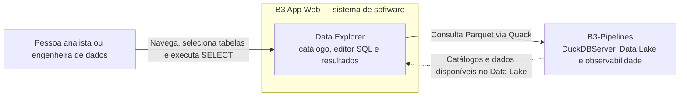
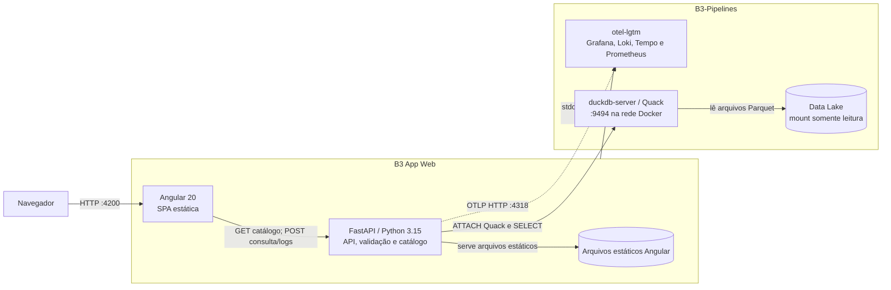

# B3 App Web

## Descrição e objetivo

O B3 App Web é o Data Explorer do ecossistema B3. Ele oferece uma interface
Angular com Bootstrap para descobrir datasets Parquet do Data Lake, escrever
consultas SQL e visualizar resultados. A API FastAPI valida e executa somente
consultas `SELECT` no DuckDBServer compartilhado do B3-Pipelines, usando o
protocolo Quack.

O objetivo é fornecer exploração local e interativa das informações já
preparadas nas camadas Bronze e Silver, sem replicar a engenharia de dados nem
publicar o servidor DuckDB no host.

## Escopo

- Descobre datasets Bronze e Silver disponíveis no Data Lake.
- Registra views locais para cada diretório ou arquivo Parquet encontrado.
- Permite consulta SQL somente leitura pelo editor da interface.
- Limita o número de linhas retornadas por consulta.
- Registra logs JSON estruturados, métricas e traces da API e eventos seguros
  do frontend.

### O que não faz

- Não orquestra DAGs nem cria, altera ou promove dados Bronze/Silver.
- Não baixa dados da B3, não mantém um catálogo persistente e não usa autenticação
  de usuário.
- Não aceita SQL que não seja uma única instrução `SELECT`.
- Não substitui o Quack ou o DuckDBServer do B3-Pipelines.
- Não oferece isolamento por usuário, autorização por tabela ou exposição segura
  para uma rede não confiável.

## Arquitetura C4

### C1 — Contexto



### C2 — Containers



O browser não acessa o DuckDBServer diretamente. Todas as consultas passam pela
API, que monta o Quack, cria um catálogo em memória e registra views sobre os
arquivos Parquet visíveis no Data Lake.

## Fluxo funcional

1. O frontend Angular carrega o catálogo pela API.
2. A API identifica diretórios Bronze/Silver que têm Parquet e cria views
   qualificadas em memória no DuckDB.
3. A pessoa seleciona uma tabela ou altera o SQL no editor.
4. A API valida que existe exatamente uma instrução `SELECT`.
5. A API executa a consulta no DuckDBServer remoto por Quack.
6. O resultado é convertido para JSON, limitado a `MAX_QUERY_ROWS` e exibido
   em tabela.
7. Eventos seguros do frontend e dados da API são registrados em métricas,
   traces e logs.

Para detalhes por escopo, consulte [a documentação da aplicação](docs/index.md).

## Requisitos

- Docker Engine ou Docker Desktop com Docker Compose v2.
- B3-Pipelines iniciado, com o DuckDBServer saudável.
- Acesso ao mesmo diretório do Data Lake e o mesmo `QUACK_TOKEN` configurado
  em B3-Pipelines.

## Configuração e execução

O `./start.sh` cria `.env` quando necessário, preservando qualquer arquivo já
existente. Na primeira execução, importa automaticamente `B3_DATA_LAKE_ROOT`,
`B3_DOCKER_NETWORK` e `QUACK_TOKEN` de `../B3-Pipelines/.env`, quando esse
arquivo existe. Revise `.env`; a raiz do Data Lake e o token devem ser os
mesmos usados pelo DuckDBServer. O arquivo `.env` é local e não deve ser
versionado. Um `.env` existente não é sincronizado quando `.env.example` muda;
variáveis opcionais ausentes usam os padrões do Compose ou do backend.

O launcher também cria `backend/venv` com as dependências do
`backend/pyproject.toml`. Para o frontend, se o lockfile estiver ausente o
launcher usa `npm install` para gerar `frontend/package-lock.json`; se o
lockfile existir, mas `frontend/node_modules` não, usa `npm ci`. Para essas
instalações locais, tenha Node.js e npm disponíveis. A imagem Docker tem seu
próprio ambiente Node e Python. O `package.json` atualmente define `build`, mas
não um script `test` para o frontend.

Inicie B3-Pipelines primeiro para criar a rede compartilhada e disponibilizar o
DuckDBServer:

```sh
cd ../B3-Pipelines
./start.sh
cd ../B3-Web-App
./start.sh
```

Abra `http://localhost:4200` (ou a porta configurada em `WEB_PORT`). O launcher
constrói a imagem, inicia o serviço e aguarda a API confirmar a conexão com o
DuckDBServer. Para parar somente a aplicação web, execute `./stop.sh`; a rede
externa e os serviços do B3-Pipelines permanecem ativos.

## Uso

O catálogo agrupa os diretórios de datasets encontrados em
`<B3_DATA_LAKE_ROOT>/bronze` e `<B3_DATA_LAKE_ROOT>/silver`. Selecione uma tabela
para preencher o editor, altere o SQL e clique em **Executar**. Os nomes ficam
qualificados pelo schema, por exemplo:

```sql
SELECT *
FROM bronze.cotacoes_historicas
LIMIT 100;
```

A API aceita apenas uma instrução `SELECT` por consulta e limita o resultado a
1.000 linhas por padrão (`MAX_QUERY_ROWS`, configurável até 100.000). O Data
Lake é montado como somente leitura no container web; as leituras e consultas
Parquet ocorrem no DuckDBServer existente.

## Observabilidade

O backend exporta traces e métricas por OTLP/HTTP para o `otel-lgtm` da rede
compartilhada do B3-Pipelines. O serviço aparece no Tempo como
`b3-web-app-api`; os spans incluem requisições HTTP, conexão/catálogo DuckDB e
consultas, sem registrar o SQL nem os valores retornados. Métricas incluem
volume e duração das requisições e consultas.

O frontend registra inicialização, carregamento do catálogo, execução/falha de
consultas e erros não tratados. Esses eventos, sem texto SQL ou dados de
consulta, são enviados à API e escritos como JSON em português no stdout do
container. O Alloy já coleta os logs dos containers pela Docker Engine API.

Abra o Grafana usado pelo B3-Pipelines (`http://localhost:3000` por padrão) e
consulte no Explore:

```logql
{service="web"} | json | frontend_event="consulta_concluida"
```

```logql
{service="web"} | json | http_path="/api/query"
```

No Tempo, filtre pelo serviço `b3-web-app-api` e procure os spans
`http.server.request` e `duckdb.query`. No Prometheus, consulte `b3_app_web_query_count_total` e
`b3_app_web_query_duration_seconds_bucket`, além de
`b3_app_web_frontend_event_count_total` e
`b3_app_web_frontend_action_duration_seconds_bucket` para eventos/latência
percebida do frontend. A exportação pode ser desligada com
`OTEL_ENABLED=false`; a coleta de logs pelo Alloy continua funcionando.

## Rede e segurança

O Compose web entra na rede externa definida por `B3_DOCKER_NETWORK` (padrão
`b3-pipelines_airflow_network`), que também é usada pelo B3-Pipelines. A porta
Quack não é publicada no host. A interface web é vinculada a `127.0.0.1`;
mantenha esse acesso local e não exponha diretamente a porta sem autenticação
e TLS.

O endpoint de consulta permite SQL `SELECT` no DuckDB compartilhado. Não
publique a aplicação para usuários não confiáveis: o token Quack autentica a
conexão ao servidor, mas não fornece autorização por tabela ou isolamento por
usuário.

## Documentação

Consulte o [índice da documentação](docs/index.md) para a visão C4 e os
diagramas UML/Mermaid por escopo:

- [Regras e requisitos](docs/regras-requisitos.md)
- [Diagrama de classes](docs/diagrama-classes.md)
- [Diagrama de componentes](docs/diagrama-componentes.md)
- [Diagrama de pacotes](docs/diagrama-pacotes.md)
- [Diagrama de atividades](docs/diagrama-atividades.md)
- [Diagrama de sequência](docs/diagrama-sequencia.md)
- [Infraestrutura](docs/infraestrutura.md)
- [Observabilidade](docs/observabilidade.md)

## Desenvolvimento

O Dockerfile compila o frontend Angular em Node.js e o entrega como arquivos
estáticos servidos pelo FastAPI. O backend usa Python 3.15 e DuckDB 2.0.
O `./start.sh` cria `backend/venv` e instala as dependências do
`backend/pyproject.toml` na primeira execução. Use esse ambiente para executar
os testes unitários do backend:

```sh
backend/venv/bin/python -m unittest discover -s tests -v
```
