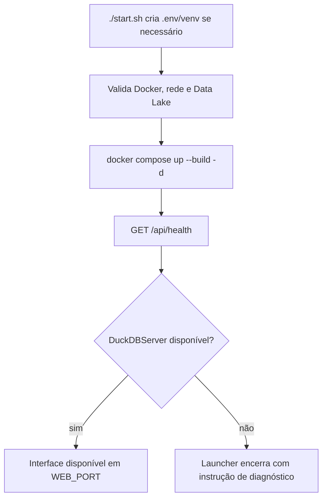
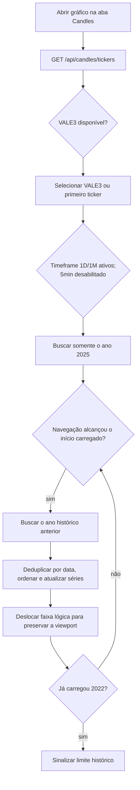
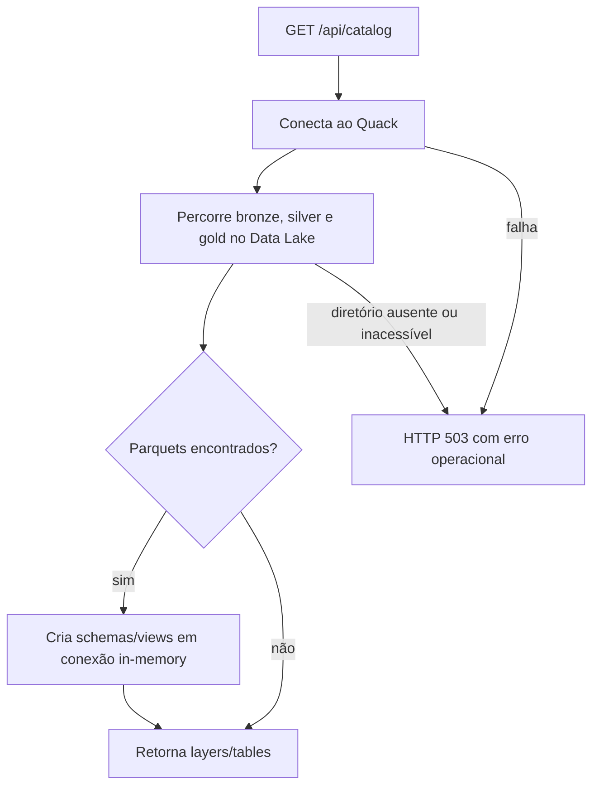
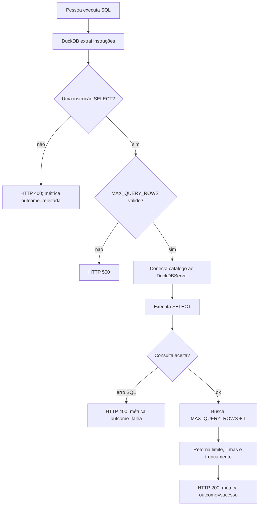

# Diagrama de atividades

## Inicialização da aplicação

O launcher não inicia o B3-Pipelines. Ele exige que a rede externa e o
DuckDBServer já estejam ativos.

## Carregamento progressivo do gráfico

## Carregamento do catálogo

## Execução de consulta

