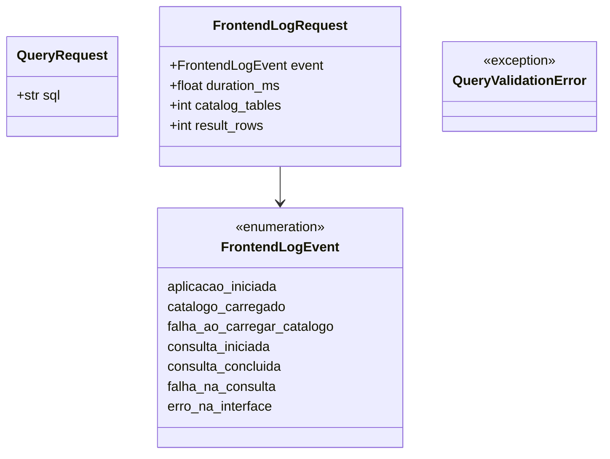
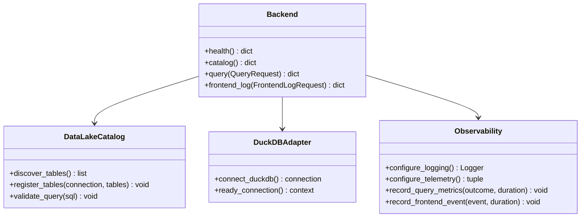
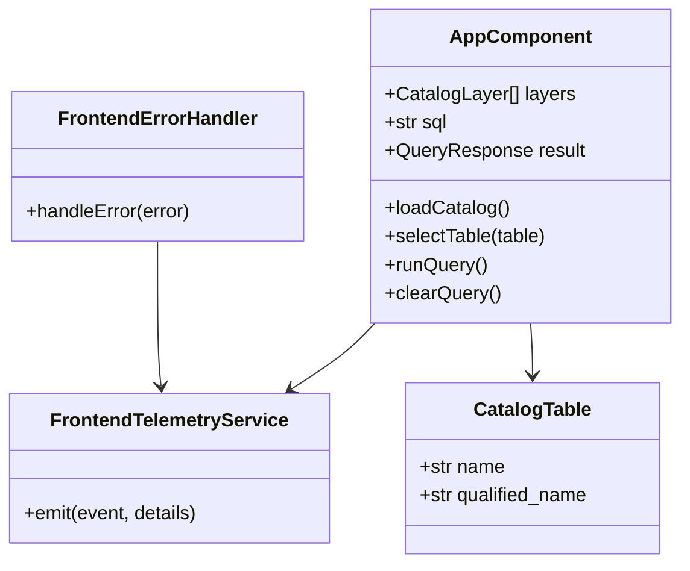

# Diagrama de classes

## Modelos da API

`QueryRequest` limita o tamanho do SQL. `FrontendLogRequest` usa `extra="forbid"`
e aceita apenas eventos conhecidos e metadados agregados. `QueryValidationError`
representa SQL ausente, inválido, múltiplo ou não permitido.

## Funções principais do backend

Os modelos diagramados representam módulos e funções reais; o projeto não usa
classes de domínio persistentes.

## Componentes principais do frontend

