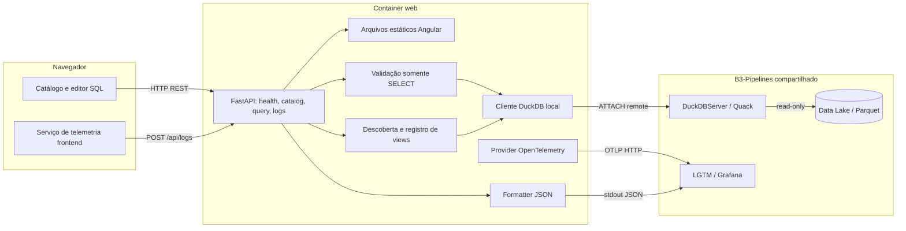
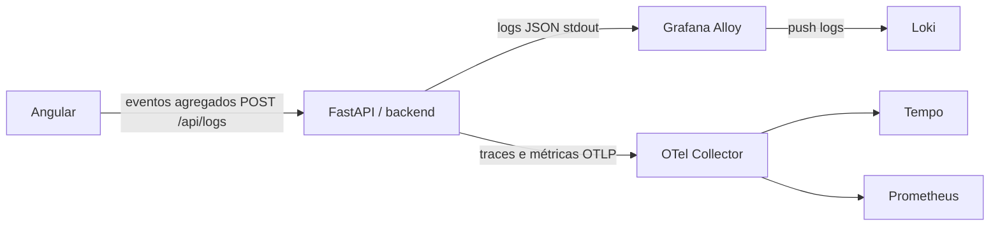

# Diagrama de componentes

## Componentes da aplicação

O frontend não contém a lógica SQL. O backend descobre tabelas no Data Lake,
valida a consulta e usa uma conexão DuckDB local como cliente do Quack.

## Observabilidade

O frontend não envia SQL, valores de linha ou texto de erro para observabilidade.
