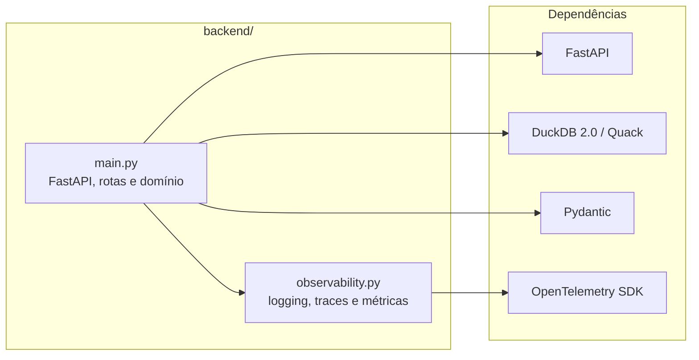
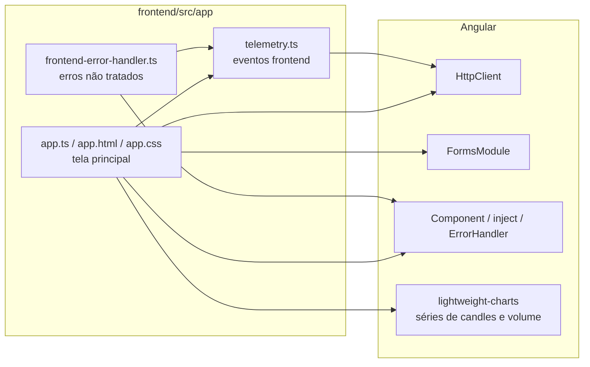

# Diagrama de pacotes

## Backend Python

`main.py` concentra descoberta do catálogo, validação SQL, execução e rotas.
`observability.py` configura logging, spans e métricas. Não há divisão em
pacotes de domínio além desses dois módulos.

## Frontend Angular

