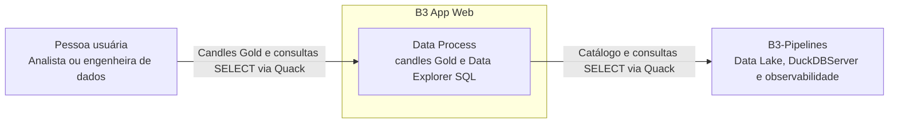
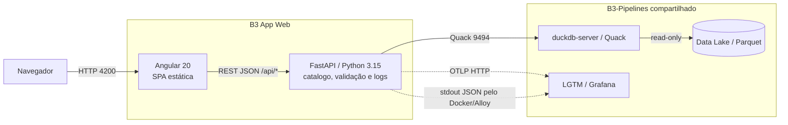

# B3 App Web — documentação

Esta documentação descreve o Data Process implementado em `B3-Web-App`.
Ela separa os contratos da API, o comportamento da interface, a integração com
o B3-Pipelines e a observabilidade.

## Objetivo

Oferecer a visualização de candles diários Gold e permitir a exploração
somente leitura dos dados Bronze, Silver e Gold já persistidos no Data Lake,
sem duplicar o pipeline de transformação nem publicar o servidor DuckDB no
host.

## Sumário

| Documento | Conteúdo |
|---|---|
| [Regras e requisitos](regras-requisitos.md) | Regras de consulta, catálogo, segurança e requisitos. |
| [Diagrama de classes](diagrama-classes.md) | Modelos Pydantic, componentes Angular e módulos principais. |
| [Diagrama de componentes](diagrama-componentes.md) | Frontend, API, DuckDBServer, Data Lake e observabilidade. |
| [Diagrama de pacotes](diagrama-pacotes.md) | Organização dos pacotes Python e Angular. |
| [Diagrama de atividades](diagrama-atividades.md) | Fluxos de inicialização, catálogo e consulta. |
| [Diagrama de sequência](diagrama-sequencia.md) | Trocas de mensagens entre navegador, API e DuckDBServer. |
| [Infraestrutura](infraestrutura.md) | Docker Compose, rede externa, volumes, variáveis e operação. |
| [Observabilidade](observabilidade.md) | Logs JSON, métricas, traces e consultas no Grafana. |

## C1 — Contexto

## C2 — Containers

