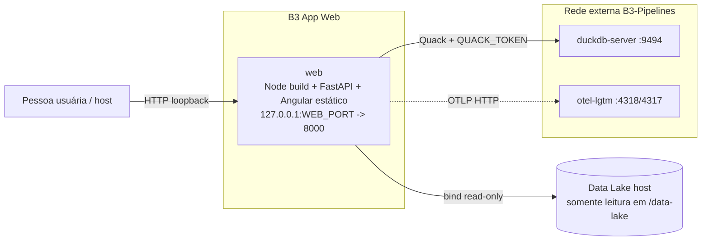

# Infraestrutura

O B3 App Web é iniciado por Docker Compose depois do B3-Pipelines. Os dois
projetos compartilham a rede Docker, o DuckDBServer e o diretório do Data Lake.

## Containers e rede



A rede externa usa por padrão `b3-pipelines_airflow_network`. Sua chave pode
ser alterada em `B3_DOCKER_NETWORK`, mas deve coincidir com o nome da rede
usada pelo Compose do B3-Pipelines.

## Variáveis

| Variável | Uso |
|---|---|
| `B3_DATA_LAKE_ROOT` | Caminho absoluto no host; reutiliza o caminho do B3-Pipelines. |
| `B3_GOLD_CANDLES_DIR` | Pasta Gold de candles; padrão `<B3_DATA_LAKE_ROOT>/gold/candles` no container. |
| `B3_DOCKER_NETWORK` | Rede externa; padrão `b3-pipelines_airflow_network`. |
| `QUACK_TOKEN` | Token compartilhado com o DuckDBServer. |
| `DUCKDB_HOST` | Nome DNS interno; padrão `duckdb-server`. |
| `DUCKDB_PORT` | Porta interna Quack; padrão `9494`. |
| `WEB_PORT` | Porta publicada no loopback; padrão `4200`. |
| `MAX_QUERY_ROWS` | Máximo de linhas por resposta; padrão `1000`, limite `100000`. |
| `OTEL_ENABLED` | Habilita traces e métricas OTLP; padrão `true`. |
| `OTEL_SERVICE_NAME` | Serviço no Tempo; padrão `b3-web-app-api`. |
| `OTEL_EXPORTER_OTLP_ENDPOINT` | Endpoint base OTLP; padrão `http://otel-lgtm:4318`. |
| `OTEL_METRIC_EXPORT_INTERVAL` | Intervalo de exportação de métricas em ms. |
| `DEPLOYMENT_ENVIRONMENT` | Ambiente usado como atributo de recurso OTel. |

## Setup e operação

```sh
./start.sh
docker compose ps
docker compose logs --tail=100 web
./stop.sh
```

`./start.sh` cria `.env` se ainda não existir, preservando qualquer configuração
existente. Quando disponível, reutiliza `B3_DATA_LAKE_ROOT`, `B3_DOCKER_NETWORK`
e `QUACK_TOKEN` do `.env` do B3-Pipelines. Também prepara `backend/venv` e,
quando `frontend/node_modules` estiver ausente, instala as dependências do
frontend com `npm ci`.

Configure a raiz do Data Lake e o token compartilhado antes de iniciar. O
launcher exige Docker Compose, diretório do Data Lake e rede externa existente.
Ele aguarda `/api/health` por até cinco minutos.

## Segurança e persistência

- A porta web usa bind `127.0.0.1`.
- O Data Lake é montado como somente leitura.
- O Quack usa token, mas não oferece TLS nesta topologia nem autorização por
  usuário/tabela.
- Não exponha a aplicação diretamente a usuários não confiáveis.
- `docker compose down` remove o container, mas não remove o Data Lake nem os
  volumes do B3-Pipelines.
- `.env` contém o token compartilhado e não deve ser versionado.
